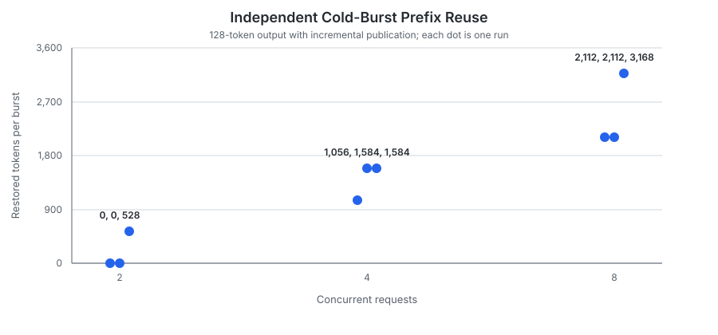
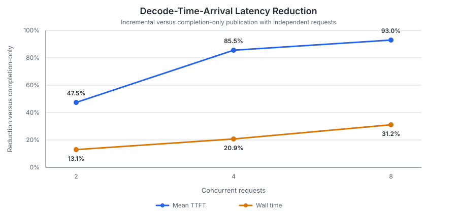
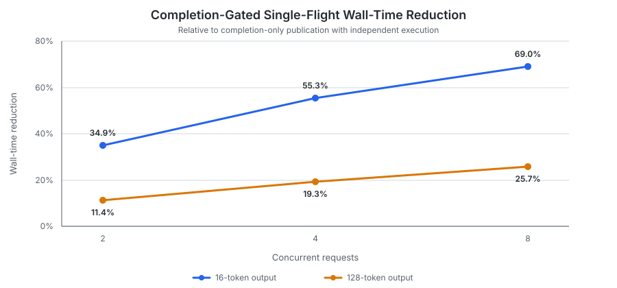
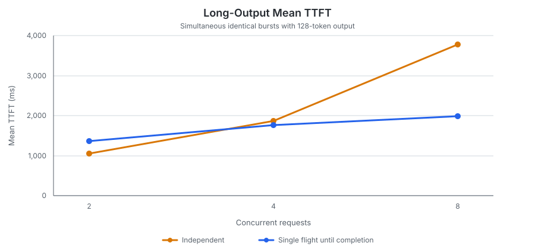
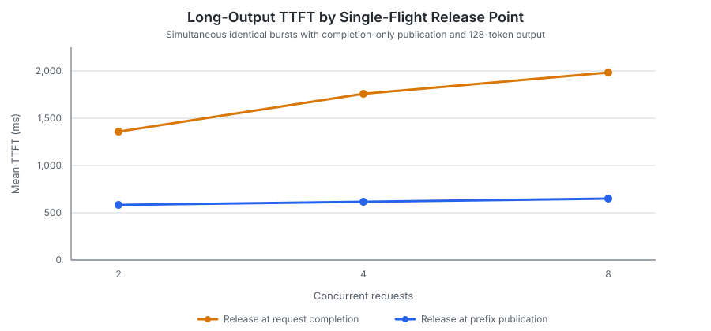
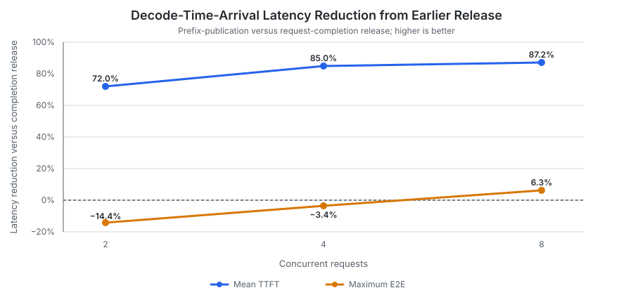

# Prefix-Cache Concurrent Population

The earlier [prefix-cache reuse benchmark](prefix_cache_reuse.md) showed that a
completed prefix substantially reduces prefill and time to first token (TTFT),
but simultaneous cold requests still duplicate the same prefill work. This
follow-up benchmark evaluates two ways to avoid that duplication:

1. **Incremental publication** publishes every newly completed cache page after
   each successful batched model forward, which may process prompt-prefill
   tokens for some active requests and decode tokens for others.
2. **Exact-input single flight** lets one request populate the prefix while
   identical followers wait. Followers can be released when the leader's whole
   request completes or as soon as its prompt prefix is published.

The benchmark crosses both publication policies with all three coordination
policies. This separates the value of making pages visible early from the value
of preventing identical cold requests from racing to fill them.

**Scope:**

- The small model and single-machine setup demonstrate policy behavior rather
  than production throughput or broad hardware scalability.
- **Exact-input single flight** matches complete input-token sequences.
  Partial-prefix matching is out of scope.
- Warm-cache bypass, waiting-follower cancellation, multi-backend routing, and
  production-grade request coalescing are also out of scope.

## Reproducibility

| Item | Details |
|---|---|
| Hardware | Apple M2 with an 8-core CPU, 10-core GPU, and 16 GB of unified memory |
| Operating system | macOS 27.0.1 |
| Model | Qwen2.5 0.5B Instruct Q4_K_M, without a draft model |
| Revisions | [`mini-vllm-rs` `7454e8b`](https://github.com/lun0522/mini-vllm-rs/commit/7454e8b35b390389c98ebebc2fc416030202ece9) and [`mini-vllm-eval` `a5ba51b`](https://github.com/lun0522/mini-vllm-eval/commit/a5ba51b3bf8bbb5bebc3e4de641cab2e3fa0a778) |
| Procedure | Follow the `prefix-cache-concurrent-population-benchmark` skill in the `mini-vllm-eval` repository and run `prefix_cache_concurrent_population` |
| Configuration | GPU inference with F32 activations; paged prefix caching; 16 tokens per page; a 128 MiB KV-cache budget; a maximum batched token count of 4,096; a maximum of 8 active requests; default FCFS scheduling |
| Policy matrix | Publication on request completion or incrementally, crossed with independent execution, exact-input single flight until request completion, and exact-input single flight until prefix publication |
| Measurements | 3 sequential untraced runs reporting the mean and sample standard deviation; every stable headline coefficient of variation was at most 5%, so the workflow did not require 2 additional runs |
| Environment overrides | No `MINI_VLLM_*` overrides; tracing disabled; `CANDLE_NUM_THREADS` and `RAYON_NUM_THREADS` unset |

## Workloads

Every prompt contains 12 deterministic paragraphs followed by a question. A
typical prompt is:

```text
exact-c4-o128 paragraph 0: A distributed inference engine schedules requests, allocates cache pages, executes model layers, and streams tokens. This deterministic paragraph supplies context for a cache coordination test.
exact-c4-o128 paragraph 1: A distributed inference engine schedules requests, allocates cache pages, executes model layers, and streams tokens. This deterministic paragraph supplies context for a cache coordination test.
...
exact-c4-o128 question: Summarize the document in one sentence.
```

Each workload uses a unique namespace, so it starts with a cold prefix even
though all workloads for one configuration share a server process.

| Workload | Requests | Input tokens per request | Reusable input tokens per follower | Output tokens | Purpose |
|---|---:|---:|---:|---:|---|
| Simultaneous identical burst | 2, 4, or 8 concurrent | 519 for the 16-token variants; 532 for the 128-token variants | 512 or 528, respectively | 16 or 128 | Measures duplicate cold prefill and whether follower release waits through decode. |
| Decode-time arrivals | 1 original request followed by 1, 3, or 7 concurrent later requests | 493 | 480 | 128 | Submits later requests after the original request's first streamed text to isolate publication timing. |
| Distinct-input control | 8 concurrent requests | 480 | 0 | 16 | Correctness check only: verifies that exact-input coordination does not serialize unrelated prompts. |

For decode-time arrivals, the original request starts alone. The remaining
requests are submitted immediately after its first streamed text, when its
prompt prefill is complete but its 128-token decode is still in progress.
Reported mean TTFT includes both the original request and these later requests.

Only complete 16-token pages are reusable.

## Results

### Metrics

- **Summed prefill:** Sum of per-request elapsed prefill durations, excluding
  queueing and request setup. A batched model step is attributed to every
  participating request, so this is not total GPU compute time.
- **Mean TTFT:** Mean time from client submission to first streamed output,
  including queueing, request setup, cache handling, and the first-token step.
- **Maximum E2E:** Slowest individual request completion latency in the group.
- **Wall time:** Client-observed duration from starting the group until all its
  requests complete.

### Incremental Publication Enabled Opportunistic Reuse

With completion-only publication and independent requests, simultaneous cold
bursts restored no tokens: every request began before any peer had published
the prefix. Incremental publication made completed pages visible while requests
were still running, so later-scheduled peers sometimes attached them. The
spread across runs shows that this reuse depended on execution order rather
than a designated publisher.



- At concurrency 2, both requests sometimes entered the same prefill batch and
  published only afterward, leaving neither able to reuse the other's pages.
- At concurrency 8, the 4,256 input tokens exceeded the configured
  `max_batched_token_count = 4096`, so requests deferred to a later batch could
  restore the prefix published by the first batch. This reuse reduced summed
  prefill by **52.7–89.3%** across the three runs.

For decode-time arrivals, later requests were submitted while the original
request was still decoding. With completion-only publication, its prefix was
not yet visible, so they restored no tokens. With incremental publication, they
restored the original request's 480-token aligned prompt.

The resulting TTFT and wall-time reductions grew with concurrency:



### Single Flight Eliminated Duplicate Cold Prefix Population Deterministically

Both exact-input single-flight policies elected one leader for a simultaneous
cold burst. At concurrency 8, the seven followers consistently restored 3,584
tokens in the short-output case and 3,696 in the long-output case across all
three runs. The leader was the only request to populate the prefix.

With completion-only publication and release at request completion, summed
prefill fell by **93.5–96.7%** at concurrency 4 and 8. Wall-time improvement
was smaller with longer output because followers remained blocked throughout
the leader's decode.



Completion gating avoided duplicate prompt prefill, but did not improve TTFT
for every request or workload shape:



As the chart shows, for **simultaneous bursts**:

- At concurrency 2, blocking one follower through the leader's 128-token decode
  cost more TTFT than avoiding one duplicate prefill saved.
- At concurrency 4 and 8, the same decode gate enabled three or seven followers
  to reuse the prefix, so the avoided prefill work and contention outweighed the
  wait.

For **decode-time arrivals**, completion-gated single flight increased mean
TTFT by **90.1%** with two requests.

### Releasing at Prefix Publication Avoided the Decode Wait

Releasing followers once the leader published its prompt retained exactly the
same restored-token counts as completion-gated single flight while allowing
followers to begin before the leader finished decoding.

For simultaneous 128-token bursts, releasing at prefix publication prevented
the leader's decode from increasingly delaying follower TTFT.



For decode-time arrivals, the later requests arrived after the original leader
had already published and closed its flight under prefix-publication release.
They therefore formed a new flight over an already warm prefix rather than being
released from the original flight. Earlier release substantially improved TTFT,
but maximum E2E did not improve uniformly:



Completion gating lets the original request decode alone, whereas prefix-
publication release overlaps its decode with the later requests. At concurrency
2, that larger active batch increased maximum E2E from 3,047.3 ms
to 3,485.0 ms even as overlap reduced group wall time from 3,609.3 ms to 3,533.9
ms. By concurrency 8, the benefit of earlier release outweighed this decode
contention.

### Publication Configuration Became Redundant Under Single Flight

The prefix-publication release policy necessarily publishes the leader's
completed prompt before admitting followers, even when the configured
publication policy is completion-only. As a result, enabling additional
incremental checkpoints changed stable coordinated wall-time and maximum E2E
measurements by approximately 1% or less in nearly every workload.

Likewise, request-completion-gated followers cannot use earlier checkpoints
until the leader finishes. Incremental and completion publication therefore
produced essentially identical results under that coordination policy too.

Incremental publication remains useful without coordination and when inputs
share a prefix but are not identical. Such requests cannot join the same
exact-input flight, but later arrivals can restore prefix pages published by an
executing request.

## Conclusions

1. **Incremental publication enables reuse before request completion, but
   simultaneous independent requests race.** It reduced decode-time-arrival
   TTFT by 47.5–93.0%, while cold-burst reuse varied with execution order.
2. **Exact-input single flight makes cold population deterministic.** One
   leader populated the prefix and every follower restored the expected
   page-aligned input in all three runs.
3. **Waiting through decode trades responsiveness for simpler coordination.**
   Completion-gated single flight reduced duplicate work and maximum E2E, but
   could increase mean TTFT for low-concurrency, long-output workloads.
4. **Prefix-publication release preserves reuse without imposing the leader's
   decode latency on followers.** It cut long-output cold-burst TTFT by
   56.9–67.4% relative to completion release, though earlier overlap did not
   improve maximum E2E in every fan-out case.
5. **Publication and coordination are complementary but partially redundant.**
   Incremental publication matters for independently arriving requests;
   single-flight release already supplies the checkpoint needed by its exact-
   input followers.

A natural next step is prefix-aware rather than exact-input coordination. That
requires deciding when overlap is large enough to wait, handling dependencies
between multiple in-progress prefixes, and comparing the coordination cost
against independent execution. Cache-aware multi-backend routing remains a
separate problem because aggregate telemetry does not identify which concrete
prefixes reside on each backend.

## Appendix: Detailed Results

All values are the mean ± sample standard deviation across three runs. Prefill,
TTFT, maximum E2E, and wall time are milliseconds. Restored tokens are totals
across the request group.

Policy abbreviations are `independent`, `until completion`, and `until
publication` for the three coordination policies.

### Simultaneous Identical Bursts: 16-Token Output

| Publication | Coordination | Concurrency | Restored | Summed prefill | Mean TTFT | Maximum E2E | Wall time |
|---|---|---:|---:|---:|---:|---:|---:|
| Completion | Independent | 2 | 0 ± 0 | 834.3 ± 25.7 | 872.8 ± 26.0 | 1,504.0 ± 27.5 | 1,537.1 ± 26.1 |
| Completion | Independent | 4 | 0 ± 0 | 5,943.4 ± 2,253.2 | 1,895.9 ± 278.2 | 2,872.6 ± 9.1 | 2,888.0 ± 8.9 |
| Completion | Independent | 8 | 0 ± 0 | 22,630.8 ± 4,463.1 | 3,654.3 ± 273.7 | 5,369.2 ± 6.8 | 5,388.2 ± 7.1 |
| Completion | Until completion | 2 | 512 ± 0 | 252.4 ± 1.5 | 682.9 ± 0.9 | 968.1 ± 1.9 | 1,000.6 ± 1.2 |
| Completion | Until completion | 4 | 1,536 ± 0 | 352.5 ± 0.2 | 724.3 ± 0.5 | 1,275.6 ± 0.7 | 1,291.2 ± 2.6 |
| Completion | Until completion | 8 | 3,584 ± 0 | 862.6 ± 7.1 | 785.1 ± 2.9 | 1,650.6 ± 2.5 | 1,668.8 ± 2.9 |
| Completion | Until publication | 2 | 512 ± 0 | 290.7 ± 1.2 | 598.5 ± 1.0 | 954.6 ± 1.3 | 988.5 ± 2.8 |
| Completion | Until publication | 4 | 1,536 ± 0 | 374.4 ± 5.8 | 607.6 ± 2.6 | 1,259.3 ± 3.1 | 1,274.4 ± 2.3 |
| Completion | Until publication | 8 | 3,584 ± 0 | 771.7 ± 45.8 | 643.7 ± 8.8 | 1,567.0 ± 14.3 | 1,589.1 ± 9.7 |
| Incremental | Independent | 2 | 512 ± 0 | 288.1 ± 1.4 | 596.7 ± 1.5 | 952.8 ± 1.6 | 985.5 ± 3.8 |
| Incremental | Independent | 4 | 1,365.3 ± 295.6 | 932.6 ± 907.7 | 781.4 ± 314.9 | 1,432.0 ± 319.2 | 1,447.0 ± 320.9 |
| Incremental | Independent | 8 | 2,730.7 ± 782.1 | 4,953.3 ± 3,905.8 | 1,532.6 ± 814.3 | 2,467.9 ± 836.8 | 2,489.2 ± 841.4 |
| Incremental | Until completion | 2 | 512 ± 0 | 250.8 ± 1.6 | 683.2 ± 0.3 | 969.4 ± 0.9 | 1,001.4 ± 2.2 |
| Incremental | Until completion | 4 | 1,536 ± 0 | 352.4 ± 0.5 | 723.6 ± 0.8 | 1,275.8 ± 1.3 | 1,290.2 ± 1.2 |
| Incremental | Until completion | 8 | 3,584 ± 0 | 862.7 ± 2.1 | 789.3 ± 4.3 | 1,653.8 ± 4.7 | 1,671.6 ± 4.8 |
| Incremental | Until publication | 2 | 512 ± 0 | 286.0 ± 3.5 | 591.7 ± 3.6 | 947.2 ± 3.1 | 973.9 ± 10.8 |
| Incremental | Until publication | 4 | 1,536 ± 0 | 370.3 ± 1.1 | 599.4 ± 3.0 | 1,250.0 ± 2.7 | 1,264.7 ± 4.5 |
| Incremental | Until publication | 8 | 3,584 ± 0 | 735.9 ± 40.3 | 640.4 ± 5.9 | 1,560.3 ± 10.9 | 1,584.4 ± 5.4 |

### Simultaneous Identical Bursts: 128-Token Output

| Publication | Coordination | Concurrency | Restored | Summed prefill | Mean TTFT | Maximum E2E | Wall time |
|---|---|---:|---:|---:|---:|---:|---:|
| Completion | Independent | 2 | 0 ± 0 | 1,567.4 ± 645.6 | 1,055.5 ± 172.9 | 4,193.5 ± 23.5 | 4,206.4 ± 24.3 |
| Completion | Independent | 4 | 0 ± 0 | 5,421.7 ± 18.5 | 1,866.4 ± 5.0 | 8,041.5 ± 34.0 | 8,054.6 ± 33.8 |
| Completion | Independent | 8 | 0 ± 0 | 23,444.6 ± 4,667.6 | 3,783.2 ± 287.8 | 12,895.6 ± 95.2 | 12,912.2 ± 95.6 |
| Completion | Until completion | 2 | 528 ± 0 | 242.0 ± 1.1 | 1,357.5 ± 2.2 | 3,715.1 ± 33.5 | 3,727.8 ± 33.5 |
| Completion | Until completion | 4 | 1,584 ± 0 | 348.2 ± 1.9 | 1,757.9 ± 15.9 | 6,484.2 ± 40.5 | 6,498.0 ± 39.8 |
| Completion | Until completion | 8 | 3,696 ± 0 | 742.8 ± 4.7 | 1,984.4 ± 14.1 | 9,571.8 ± 18.3 | 9,588.2 ± 17.3 |
| Completion | Until publication | 2 | 528 ± 0 | 271.7 ± 0.8 | 584.7 ± 1.9 | 3,615.1 ± 1.3 | 3,627.6 ± 1.2 |
| Completion | Until publication | 4 | 1,584 ± 0 | 373.7 ± 0.5 | 617.1 ± 0.8 | 6,278.3 ± 4.2 | 6,291.8 ± 4.3 |
| Completion | Until publication | 8 | 3,696 ± 0 | 707.8 ± 35.3 | 646.7 ± 7.3 | 8,718.0 ± 6.6 | 8,740.6 ± 10.3 |
| Incremental | Independent | 2 | 176.0 ± 304.8 | 1,387.5 ± 965.2 | 966.8 ± 331.4 | 4,023.2 ± 353.6 | 4,035.8 ± 353.5 |
| Incremental | Independent | 4 | 1,408.0 ± 304.8 | 948.8 ± 950.5 | 800.2 ± 331.5 | 6,482.8 ± 342.7 | 6,496.2 ± 342.5 |
| Incremental | Independent | 8 | 2,464.0 ± 609.7 | 6,869.7 ± 3,844.9 | 1,954.8 ± 641.3 | 10,150.9 ± 720.6 | 10,172.7 ± 725.7 |
| Incremental | Until completion | 2 | 528 ± 0 | 241.4 ± 0.4 | 1,364.0 ± 7.7 | 3,713.9 ± 12.5 | 3,736.0 ± 12.4 |
| Incremental | Until completion | 4 | 1,584 ± 0 | 348.0 ± 0.9 | 1,767.6 ± 4.5 | 6,515.0 ± 9.8 | 6,528.4 ± 10.0 |
| Incremental | Until completion | 8 | 3,696 ± 0 | 743.2 ± 1.4 | 1,993.2 ± 2.8 | 9,583.0 ± 7.9 | 9,598.8 ± 8.2 |
| Incremental | Until publication | 2 | 528 ± 0 | 271.0 ± 1.7 | 583.2 ± 1.5 | 3,626.2 ± 20.6 | 3,638.9 ± 20.5 |
| Incremental | Until publication | 4 | 1,584 ± 0 | 387.1 ± 14.0 | 618.7 ± 17.8 | 6,318.0 ± 37.8 | 6,331.5 ± 38.1 |
| Incremental | Until publication | 8 | 3,696 ± 0 | 703.5 ± 41.2 | 646.5 ± 7.6 | 8,730.4 ± 38.6 | 8,752.9 ± 33.1 |

### Decode-Time Arrivals

| Publication | Coordination | Concurrency | Restored | Summed prefill | Mean TTFT | Maximum E2E | Wall time |
|---|---|---:|---:|---:|---:|---:|---:|
| Completion | Independent | 2 | 0 ± 0 | 751.5 ± 12.2 | 540.9 ± 6.2 | 4,014.0 ± 26.0 | 4,062.4 ± 26.2 |
| Completion | Independent | 4 | 0 ± 0 | 4,995.0 ± 7.1 | 1,339.0 ± 2.0 | 7,658.0 ± 20.1 | 7,775.4 ± 20.6 |
| Completion | Independent | 8 | 0 ± 0 | 13,576.6 ± 47.9 | 2,541.2 ± 11.9 | 12,160.9 ± 26.3 | 12,375.2 ± 50.2 |
| Completion | Until completion | 2 | 480 ± 0 | 201.0 ± 0.9 | 1,028.0 ± 0.7 | 3,047.3 ± 4.4 | 3,609.3 ± 4.0 |
| Completion | Until completion | 4 | 1,440 ± 0 | 362.4 ± 0.4 | 1,311.6 ± 5.7 | 5,819.7 ± 2.7 | 6,386.5 ± 7.7 |
| Completion | Until completion | 8 | 3,360 ± 0 | 1,036.2 ± 2.6 | 1,489.3 ± 0.7 | 8,819.2 ± 25.0 | 9,385.3 ± 24.4 |
| Completion | Until publication | 2 | 480 ± 0 | 238.0 ± 1.9 | 287.7 ± 6.0 | 3,485.0 ± 8.8 | 3,533.9 ± 9.2 |
| Completion | Until publication | 4 | 1,440 ± 0 | 353.1 ± 1.3 | 196.9 ± 1.2 | 6,014.7 ± 4.4 | 6,154.7 ± 4.5 |
| Completion | Until publication | 8 | 3,360 ± 0 | 735.9 ± 1.2 | 190.6 ± 1.4 | 8,260.8 ± 5.4 | 8,529.1 ± 5.2 |
| Incremental | Independent | 2 | 480 ± 0 | 236.3 ± 0.2 | 283.8 ± 0.6 | 3,481.4 ± 1.8 | 3,529.9 ± 1.8 |
| Incremental | Independent | 4 | 1,440 ± 0 | 418.4 ± 1.4 | 194.0 ± 1.1 | 6,030.9 ± 3.9 | 6,146.9 ± 3.7 |
| Incremental | Independent | 8 | 3,360 ± 0 | 806.0 ± 4.1 | 178.9 ± 1.4 | 8,307.7 ± 32.6 | 8,516.5 ± 9.4 |
| Incremental | Until completion | 2 | 480 ± 0 | 201.0 ± 0.5 | 1,030.0 ± 1.4 | 3,050.6 ± 5.9 | 3,614.4 ± 5.6 |
| Incremental | Until completion | 4 | 1,440 ± 0 | 361.6 ± 0.8 | 1,314.8 ± 3.2 | 5,826.6 ± 2.0 | 6,390.1 ± 2.5 |
| Incremental | Until completion | 8 | 3,360 ± 0 | 1,034.0 ± 2.6 | 1,489.0 ± 2.4 | 8,802.1 ± 8.7 | 9,367.7 ± 10.2 |
| Incremental | Until publication | 2 | 480 ± 0 | 236.3 ± 0.2 | 284.4 ± 2.1 | 3,478.8 ± 1.4 | 3,527.3 ± 1.4 |
| Incremental | Until publication | 4 | 1,440 ± 0 | 353.5 ± 0.5 | 195.3 ± 2.3 | 6,023.9 ± 18.2 | 6,153.4 ± 6.7 |
| Incremental | Until publication | 8 | 3,360 ± 0 | 735.2 ± 2.8 | 190.0 ± 1.0 | 8,239.1 ± 7.6 | 8,506.6 ± 8.2 |

### Distinct-Input Control

| Publication | Coordination | Restored | Summed prefill | Mean TTFT | Maximum E2E | Wall time |
|---|---|---:|---:|---:|---:|---:|
| Completion | Independent | 0 ± 0 | 17,379.2 ± 2,360.1 | 3,152.6 ± 148.8 | 4,992.9 ± 14.8 | 5,022.1 ± 26.3 |
| Completion | Until completion | 0 ± 0 | 19,400.3 ± 5,026.9 | 3,270.4 ± 306.8 | 4,978.3 ± 5.2 | 4,996.0 ± 8.0 |
| Completion | Until publication | 0 ± 0 | 19,395.8 ± 5,042.6 | 3,269.3 ± 309.7 | 4,987.1 ± 15.8 | 5,004.7 ± 14.0 |
| Incremental | Independent | 0 ± 0 | 20,786.2 ± 4,092.3 | 3,359.8 ± 249.2 | 4,985.6 ± 9.7 | 5,000.6 ± 9.7 |
| Incremental | Until completion | 0 ± 0 | 21,802.5 ± 2,924.4 | 3,424.3 ± 172.9 | 4,986.6 ± 9.1 | 5,002.8 ± 9.2 |
| Incremental | Until publication | 0 ± 0 | 22,120.4 ± 5,290.7 | 3,437.3 ± 322.4 | 4,970.2 ± 16.1 | 4,987.8 ± 19.3 |

### Whole-Run Cache Telemetry

Telemetry was queried after all 10 workloads for each server configuration.
Stable cases were identical across all three runs:

A generated token gains a KV state when it is processed by the next decode
step, so the final sampled token is not indexed. After rounding down to complete
16-token pages, the three short bursts, three long bursts, three decode-time-
arrival workloads, and eight distinct inputs contributed 3 × 528, 3 × 656, 3 ×
608, and 8 × 480 newly indexed tokens, respectively. Their cumulative total was
9,216.

| Publication | Coordination | Capacity | Current indexed | Cumulative indexed | Cumulative evicted | Cumulative restored | Lookups | Hits |
|---|---|---:|---:|---:|---:|---:|---:|---:|
| Completion | Independent | 5,456 | 4,912 | 9,216 | 4,304 | 0 | 50 | 0 |
| Completion | Until request completion | 5,456 | 5,328 | 9,216 | 3,888 | 16,720 | 50 | 33 |
| Completion | Until prefix publication | 5,456 | 5,328 | 9,216 | 3,888 | 16,720 | 50 | 33 |
| Incremental | Until request completion | 5,456 | 5,328 | 9,216 | 3,888 | 16,720 | 50 | 33 |
| Incremental | Until prefix publication | 5,456 | 5,328 | 9,216 | 3,888 | 16,720 | 50 | 33 |

Incremental independent execution was race-sensitive: it restored 15,136,
12,032, and 14,640 tokens and recorded 30, 24, and 29 hits in the three runs.
Its capacity, current indexed, cumulative indexed, and cumulative evicted
values were stable at 5,456, 5,328, 9,216, and 3,888 tokens.

A hit means that one request restored at least one page; it is not a
token-weighted hit rate. There were 50 lookups per configuration because each
configuration executed 50 requests.

### Variance Decision

Three runs were sufficient because every stable headline coefficient of
variation was at most 5%. The analyzer reported, but intentionally excluded
from the extra-run decision, these race-sensitive incremental-independent cold
bursts:

- concurrency 8, 16-token output: maximum E2E CV 33.9%, wall-time CV 33.8%;
- concurrency 8, 128-token output: maximum E2E CV 7.1%, wall-time CV 7.1%.
