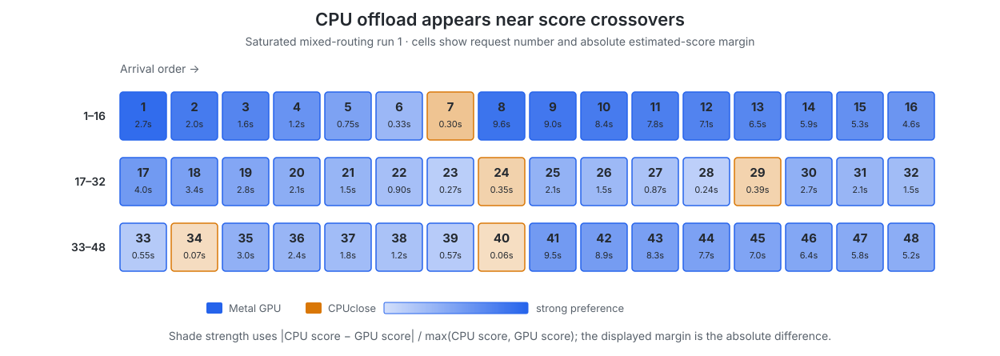
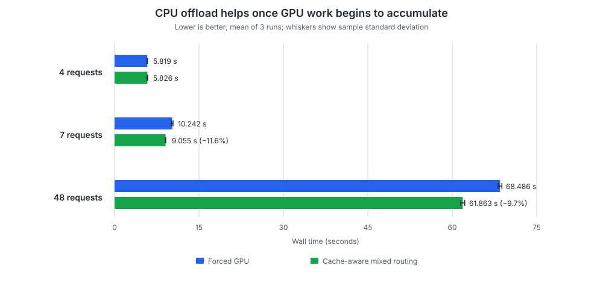
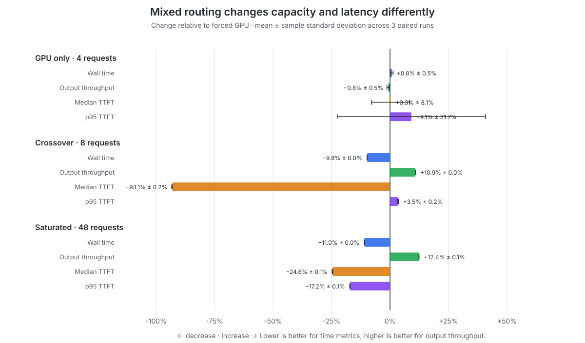
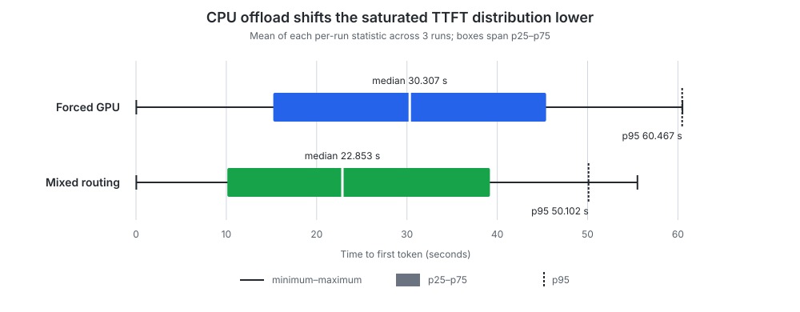

# Request Orchestration Capacity

The [request-orchestration policy benchmark](request_orchestration.md) found
that estimated-work routing completed its workloads fastest by assigning 11 of
12 requests to the substantially faster GPU. This follow-up asks when the CPU
becomes useful despite that speed difference.

The measured profile for this workload puts GPU prefill at 2,551 tok/s versus
73 tok/s on CPU, a roughly 35× advantage. Decode narrows the gap to 293 versus
45 tok/s, or about 6.5×. The benchmark therefore pre-populates the same prefix
cache on both backends, leaving only a few input tokens to prefill, and uses
128-token outputs so decode dominates. This gives the CPU its best plausible
chance to help once GPU work accumulates.

The benchmark holds the routing policy, request shape, cached prefix,
throughput profiles, scheduler, and arrival interval constant while increasing
the measured request count. It compares **cache-aware least estimated work**
with a forced-GPU control to determine when using the slower CPU adds useful
parallel capacity.

**Scope:**

- This is a controlled capacity experiment on one machine and one small model,
  not a sustained-arrival workload or a general CPU/GPU crossover threshold.
- The benchmark studies one routing policy using the measured throughput-profile
  matrix. It does not repeat the five-policy comparison from the earlier report.
- Prompt diversity, natural stopping behavior, output quality, speculative
  decoding, and alternative scheduler settings are out of scope.

## Reproducibility

| Item | Details |
|---|---|
| Hardware | Apple M2 with an 8-core CPU, 10-core GPU, and 16 GB of unified memory |
| Operating system | macOS 27.0.1 |
| Model | Qwen2.5 0.5B Instruct Q4_K_M, without a draft model |
| Revisions | [`mini-vllm-rs` `5b3e211`](https://github.com/lun0522/mini-vllm-rs/commit/5b3e21118ce884e485d938d67e1c2b7ae731a237) and [`mini-vllm-eval` `92de24d`](https://github.com/lun0522/mini-vllm-eval/commit/92de24dedea8293ccba8125d017e2176c24b7995) |
| Procedure | Follow the `request-orchestration-capacity-benchmark` skill in the `mini-vllm-eval` repository and run `request_orchestration_capacity` |
| Configuration | Mixed CPU/Metal GPU inference with F32 activations; **cache-aware least estimated work** routing using the measured 12-point [throughput-profile matrix](backend_throughput_profiles.textproto); separate 256 MiB paged prefix caches; maximum 2,048 batched tokens and 4 active requests per backend |
| Requests | Approximately 516 input tokens, 128 output tokens, EOS ignored; submissions start 50 ms apart and responses are consumed concurrently |
| Measurements | 3 sequential untraced invocations; every case starts a fresh server; values report the mean and sample standard deviation |
| Environment overrides | Tracing disabled; `CANDLE_NUM_THREADS` and `RAYON_NUM_THREADS` unset |

The 50 ms interval and single preprocessing thread make request order
repeatable while allowing earlier requests to remain in flight.

## Workloads

Backend 1 runs on the CPU, and backend 2 runs on the Metal GPU. Before each
measured workload, two unmeasured **seed requests** place the same approximately
512-token prefix in both backend caches. Every measured request then uses the
same 516-token prompt, restores the seeded prefix, and generates 128 tokens.

Each workload runs twice on a fresh server:

- **Forced GPU:** A benchmark-only request field assigns every measured request
  to backend 2.
- **Mixed routing:** **Cache-aware least estimated work** selects between the
  CPU and GPU from cache-affinity snapshots, published load, and outstanding
  ingress reservations for dispatched work not yet reflected in worker load.

Exploratory runs varied the request count and found that CPU offloading began
with the 7th request; 6 requests still stayed entirely on the GPU. The measured
crossover case therefore uses 7 requests to capture the first CPU assignment.

| Workload | Requests | Purpose |
|---|---:|---|
| `GPU only` | 4 | Fits one full GPU active set and checks that the policy avoids the slower CPU while the GPU has immediate capacity. |
| `Crossover` | 7 | Adds enough GPU backlog to capture the first calibrated CPU assignment. |
| `Saturated` | 48 | Maintains a long GPU backlog so useful parallel CPU capacity can emerge. |

The workload names describe this measured configuration. They should be
recalibrated after changing the model, hardware, request shape, pacing, or
throughput profiles.

## Results

### Metrics

- **Wall time:** Time from the first measured submission until all responses
  have been consumed; excludes server startup and seed requests.
- **Aggregate output throughput:** Total generated tokens divided by wall time.
- **TTFT (time to first token):** Time from client submission until its first
  streamed output.
- **E2E (end-to-end latency):** Time from client submission until its final
  streamed output.
- **p25, p75, and p95:** The 25th-, 75th-, and 95th-percentile request
  latencies within one benchmark invocation.
- **Restored tokens:** Page-aligned input tokens reused from a backend's prefix
  cache, summed across measured requests.

### CPU Use Increased with GPU Backlog

Mixed routing kept the 4-request workload entirely on the GPU. It consistently
sent request 7 to CPU in the crossover workload, then assigned 5, 6, and 5 of
the 48 saturated requests to CPU across the three runs:

| Workload | CPU / GPU requests | Closest estimated-score margin |
|---|---:|---:|
| `GPU only` | 0 / 4 | 1.175 ± 0.000 s |
| `Crossover` | 1 / 6 | 0.297 ± 0.003 s |
| `Saturated` | 5 / 43, 6 / 42, 5 / 43 | 0.037 ± 0.030 s |

The score margin is the absolute difference between the two candidates'
estimated completion durations. The first saturated run below shows each
request in arrival order: blue selected the GPU, orange selected the CPU, and
lighter shades indicate closer scores. Each block also gives its absolute score
margin. The first CPU assignment was repeatable and not an equal-score tie, but
later decisions approached the crossover as GPU reservations accumulated.

Requests 7, 24, and 29 went to CPU in every run; the later assignments were 34
and 40 in two runs, but 35, 41, and 46 in the other. The 5/6/5 variation is
consistent with routing decisions close to the estimated crossover.

This is the intended heterogeneous placement: the policy did not try to split
requests evenly. It used the CPU occasionally when parallel execution there
was estimated to finish sooner than joining the GPU backlog.

### CPU Offload Improved Capacity

Wall time shows when mixed routing began benefiting from additional CPU
capacity relative to the forced-GPU control.

- At 4 requests, mixed routing and the forced-GPU control had effectively equal
  wall time.
- At 7 requests, moving the final request to CPU reduced wall time from
  **10.242 to 9.055 seconds** and increased aggregate output throughput from
  **87.496 to 98.948 tok/s**.
- At 48 requests, assigning 5 or 6 requests to CPU reduced wall time from
  **68.486 to 61.863 seconds** and increased throughput from **89.713 to 99.318
  tok/s**.

Capacity and latency did not move uniformly. The chart reports mixed routing's
relative change from its paired forced-GPU control; whiskers show sample
standard deviation across the three runs.

The 7-request case shows a capacity crossover, not a uniform latency win. CPU
offload shortened overall completion time and p95 E2E latency by 11.6%, but its
median and p95 TTFT changes were small-sample comparisons and did not improve.

### Offload Shifted the Saturated TTFT Distribution

The saturated benefit was distributed across the request set: mixed routing
shifted the TTFT distribution lower at every reported percentile.

The largest relative improvement occurred in the lower half of the
distribution because early CPU assignments began producing output while the
GPU queue grew. Later requests also benefited as those assignments removed work
from the GPU backlog. Median E2E latency fell by **20.8%**, and p95 E2E latency
fell by **11.5%**. The mixed-routing p95 varied more than the center of the
distribution; its lowest value occurred in the run with six CPU assignments
instead of five.

## Conclusions

1. **The policy avoided unnecessary CPU work at low concurrency.** It routed all
   4-request workloads to the GPU and matched the forced-GPU control.
2. **The seventh request crossed the measured routing boundary.** Sending that
   request to CPU reduced wall time by 11.6% versus forcing all seven onto GPU.
3. **A slower backend still added useful capacity under sustained backlog.**
   Five or six CPU assignments in the 48-request workload reduced wall time by
   9.7% and raised aggregate output throughput by 10.7%.
4. **Useful offload did not require an even split.** Routing roughly one-tenth
   of saturated requests to CPU improved the TTFT and E2E distributions while
   leaving most work on the faster GPU.
5. **The crossover is workload-specific.** Equal prefix availability, fixed
   128-token outputs, paced submission, ingress reservations, and measured
   throughput profiles all influence when the CPU becomes competitive. Cached
   prefixes avoided expensive CPU prefill; uncached inputs would move the
   crossover.

## Appendix: Complete Measurements

### Case Results

Values are mean ± sample standard deviation across three invocations. Restored
tokens are summed over measured requests and were identical across runs.

| Workload | Routing | CPU / GPU | Wall (s) | Output (tok/s) | Median TTFT (ms) | p95 TTFT (ms) | Median E2E (s) | p95 E2E (s) | Restored tokens |
|---|---|---:|---:|---:|---:|---:|---:|---:|---:|
| `GPU only` | Forced GPU | 0 / 4 | 5.819 ± 0.040 | 87.986 ± 0.601 | 57.703 ± 5.922 | 71.988 ± 8.342 | 5.679 ± 0.044 | 5.702 ± 0.031 | 1,984 |
| `GPU only` | Mixed | 0 / 4 | 5.826 ± 0.060 | 87.892 ± 0.900 | 53.247 ± 3.975 | 61.261 ± 1.614 | 5.692 ± 0.059 | 5.716 ± 0.060 | 1,984 |
| `Crossover` | Forced GPU | 0 / 7 | 10.242 ± 0.151 | 87.496 ± 1.279 | 68.897 ± 10.825 | 5,581.646 ± 25.666 | 5.732 ± 0.027 | 9.956 ± 0.155 | 3,520 |
| `Crossover` | Mixed | 1 / 6 | 9.055 ± 0.043 | 98.948 ± 0.471 | 74.087 ± 14.188 | 5,793.141 ± 21.169 | 5.948 ± 0.035 | 8.804 ± 0.049 | 3,504 |
| `Saturated` | Forced GPU | 0 / 48 | 68.486 ± 0.338 | 89.713 ± 0.443 | 30,324.601 ± 147.043 | 60,566.641 ± 340.516 | 35.965 ± 0.177 | 66.141 ± 0.321 | 24,512 |
| `Saturated` | Mixed | 5–6 / 42–43 | 61.863 ± 0.359 | 99.318 ± 0.577 | 22,817.336 ± 174.542 | 53,774.825 ± 2,743.322 | 28.485 ± 0.241 | 58.561 ± 1.967 | 24,448 |

The 64-token difference is 0.26% of the forced-GPU total. In the forced-GPU
case, 4 requests restored 496 tokens and 44 restored 512; mixed routing had 8
and 40 requests in those groups. This reflects backend-local, page-aligned
cache growth during the concurrent replay. Every measured request restored a
nonzero prefix.

### Saturated TTFT Distribution

The table reports the mean of each invocation's distribution statistic.

| Routing | Minimum | p25 | Median | p75 | p95 | Maximum |
|---|---:|---:|---:|---:|---:|---:|
| Forced GPU | 0.039 s | 11.114 s | 30.325 s | 44.094 s | 60.567 s | 60.574 s |
| Mixed | 0.039 s | 5.829 s | 22.817 s | 39.202 s | 53.775 s | 55.632 s |

### Variance and Validation

The 4- and 7-request backend assignments were identical across all three runs.
The saturated case used CPU five times in runs 1 and 3 and six times in run 2,
as expected from its much narrower score margin. The analyzer also verified
both seed destinations, nonzero cache reuse, request IDs, routing epochs,
candidate duration estimates, and selection of the minimum estimated score for
every mixed-routing request.

All wall-time and aggregate-throughput coefficients of variation (CV) were at
most 1.47%. Five small-workload TTFT metrics exceeded 5%, with a maximum of
19.15% for the mixed crossover median. Saturated mixed-routing p95 TTFT had
5.10% CV; its three values were 55.315, 50.608, and 55.402 seconds, with the
lower value occurring in the run that sent six rather than five requests to CPU.

The small-workload TTFT percentages are sensitive to millisecond-scale changes
and medians over only four or seven requests. Placement, wall time, and output
throughput were stable at the crossover, while the saturated placement change
explains its wider tail-latency variation. No runs were discarded.
