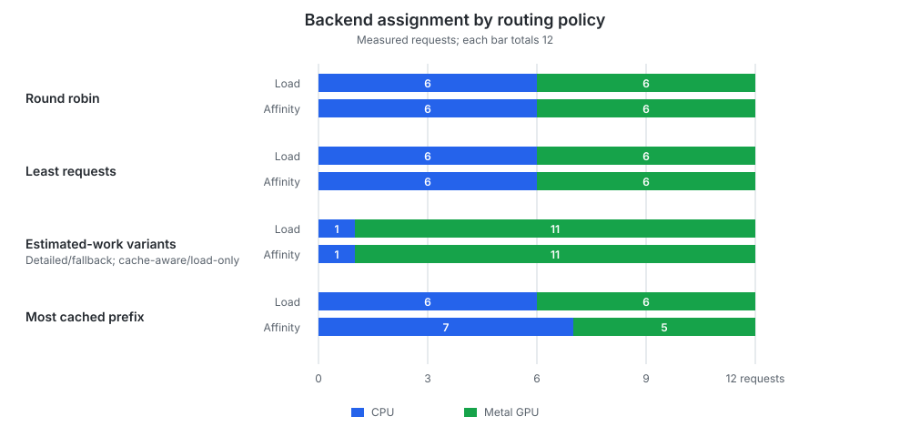
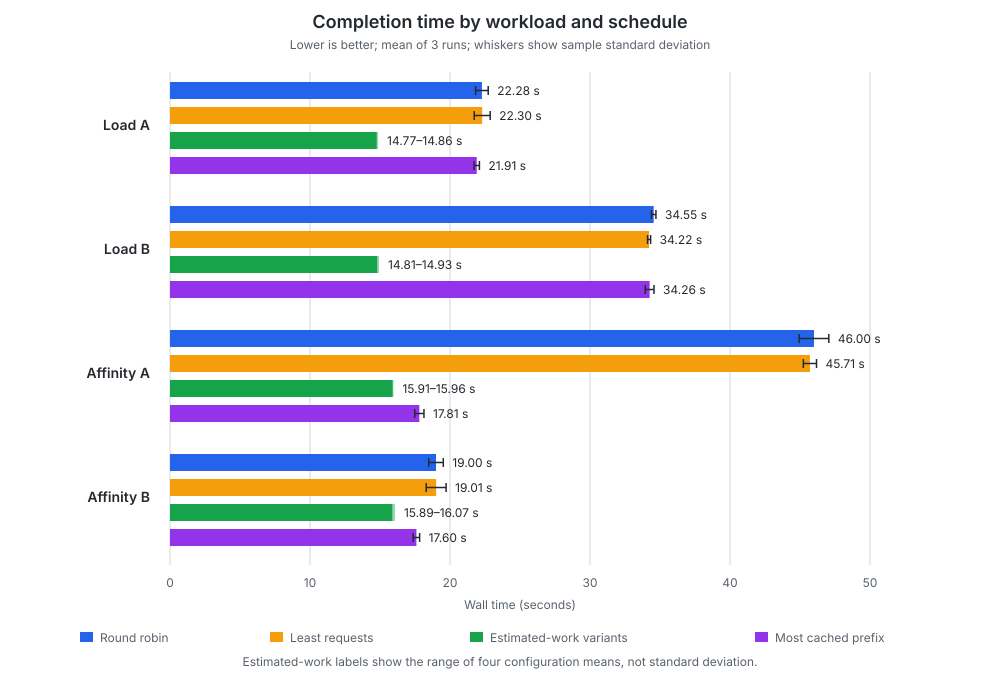
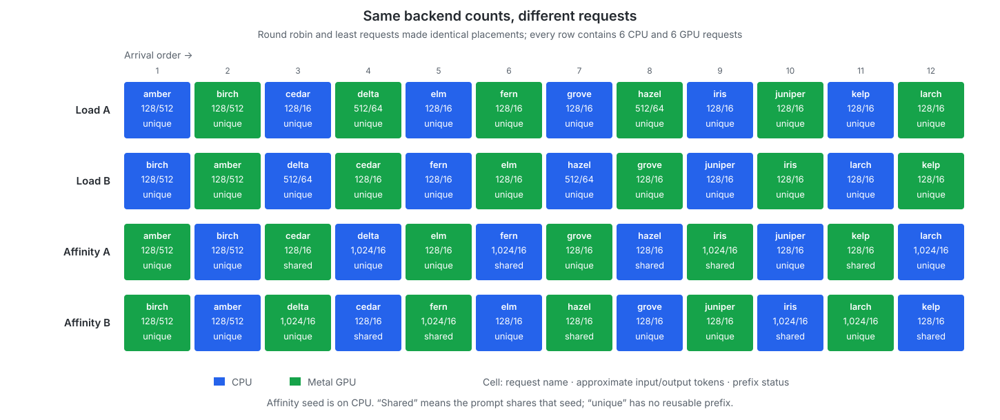
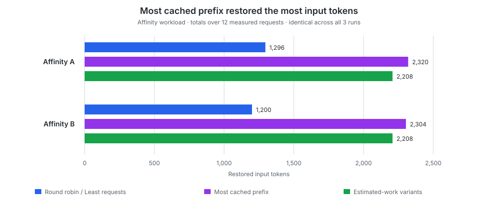
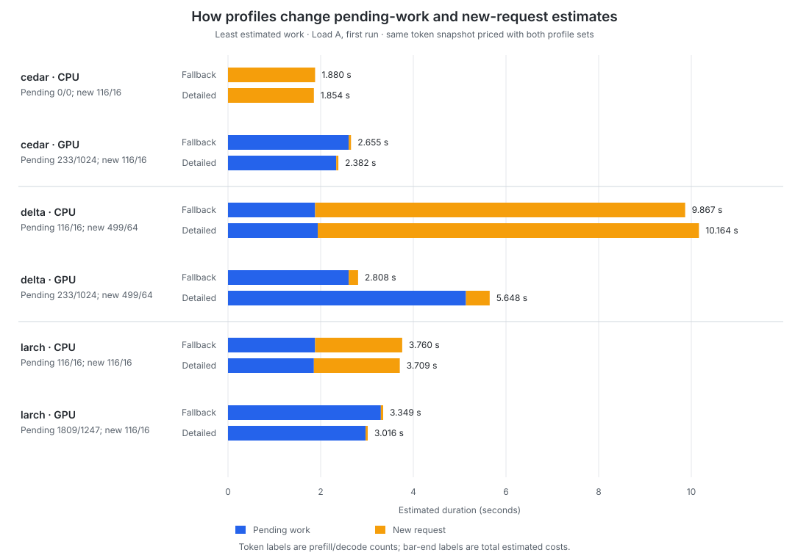
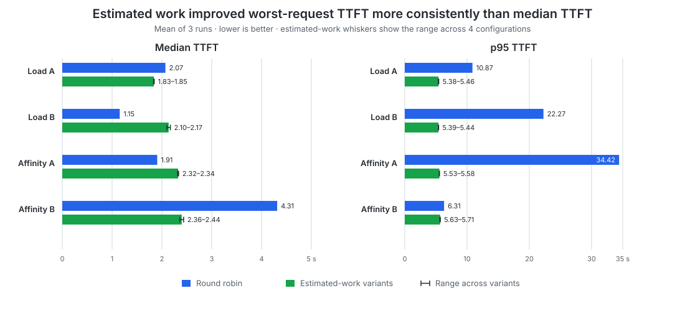

# Request Routing Policies

Request routing selects which inference backend receives a whole request. Each
backend has its own scheduler and KV cache, so this decision determines both
which device performs the work and which cached prefixes the request can reuse.
This is separate from [scheduling](scheduling_policies.md), which orders
requests after they have been assigned to one backend.

This benchmark compares five routing policies across one CPU and one Metal GPU
backend:

| Policy | Selection behavior |
|---|---|
| **Round robin** | Cycles through backends without considering load or cache contents. |
| **Least requests** | Minimizes queued, active, and reserved request count. |
| **Least estimated work** | Minimizes estimated prefill and decode duration using backend throughput profiles. |
| **Most cached prefix** | Maximizes the estimated cached input-prefix length without considering backend load. |
| **Cache-aware least estimated work** | Minimizes estimated duration after discounting cached input-prefix tokens. |

The two estimated-work policies are each tested with the complete measured
[throughput-profile matrix](backend_throughput_profiles.md) and with a single
fallback profile. Separate `Load` and `Affinity` workloads show whether
balancing request counts, estimating execution time, or retaining cache
locality leads to different placements and completion times.

A [capacity follow-up](request_orchestration_capacity.md) holds the best-performing
policy and request shape constant while increasing concurrency to find when the
CPU becomes useful alongside the faster GPU.

**Scope:**

- This is a single-machine, small-model comparison at modest concurrency, not
  a production traffic model, sustained-load test, or hardware scalability
  study.
- Estimated work uses the request's maximum output length because the engine
  does not predict how many tokens a natural generation will produce.
- Speculative decoding, scheduling and cache-publication policy comparisons,
  single flight, output quality, and memory use are out of scope.

## Reproducibility

| Item | Details |
|---|---|
| Hardware | Apple M2 with an 8-core CPU, 10-core GPU, and 16 GB of unified memory |
| Operating system | macOS 27.0.1 |
| Model | Qwen2.5 0.5B Instruct Q4_K_M, without a draft model |
| Revisions | [`mini-vllm-rs` `09be6b2`](https://github.com/lun0522/mini-vllm-rs/commit/09be6b2e18494830f5f621a0868fe09c50027cad) and [`mini-vllm-eval` `9909da9`](https://github.com/lun0522/mini-vllm-eval/commit/9909da9f795f2f7751e3618f3d3067823308e44b) |
| Procedure | At the recorded revision, follow the then-named `request-orchestration-benchmark` skill in the `mini-vllm-eval` repository and run `request_orchestration` |
| Configuration | Mixed CPU/Metal GPU inference with F32 activations; separate 256 MiB paged prefix caches with 16 tokens per page; a maximum batched token count of 2,048; a maximum of 4 active requests per backend; default first-come-first-served scheduling; completion-time prefix publication; independent prefix-cache coordination; one input-preprocessing thread |
| Workloads | `Load` and `Affinity` scenarios with 12 requests submitted 50 ms apart under 2 fixed schedules; responses were consumed concurrently and EOS was ignored |
| Throughput profiles | The complete measured 12-point [profile matrix](backend_throughput_profiles.textproto), or the fallback profile: CPU prefill/decode 75/48 tok/s and GPU prefill/decode 12,086/396 tok/s |
| Measurements | 3 sequential untraced runs reporting the mean and sample standard deviation; wall-time and aggregate-throughput coefficients of variation were at most 3.76%, while the maximum headline coefficient of variation was 7.43% for **Round robin** `Load` A median TTFT; backend assignments, wall time, and throughput remained stable on inspection, so no additional runs were collected |
| Environment overrides | Tracing disabled; `CANDLE_NUM_THREADS` and `RAYON_NUM_THREADS` unset |

The 50 ms submission interval and single input-preprocessing thread reduce
arrival-order variation from concurrent preprocessing, making routing decisions
more reproducible while earlier requests remain in flight.

## Workloads

Every case starts a fresh server. Backend 1 is the CPU and backend 2 is the
Metal GPU. Requests are submitted 50 ms apart without waiting for earlier
requests to complete, and their responses are consumed concurrently.

For `Affinity`, a **seed request** is an unmeasured request completed before the
measured workload so its prefix is present in one backend's KV cache.

| Workload | Requests | Cache setup | Purpose |
|---|---|---|---|
| Heterogeneous request load (`Load`) | 2 backlog requests at approximately 128 input/512 output tokens, 8 short requests at 128/16, and 2 medium requests at 512/64; every prompt is unique | No seed | Measures whether a policy accounts for request size and heterogeneous backend speed as work accumulates. |
| Seeded prefix affinity (`Affinity`) | 2 backlog requests at 128/512, 6 short requests at 128/16, and 4 prefix probes at 1,024/16 | A completed, unmeasured 1,056-token seed; 3 short requests and 2 probes share its prefix | Measures the tradeoff between cache locality, backend load, and device speed. |

Each workload uses two fixed schedules with identical request sets, which are
separate workload variants rather than repeated measurements: schedule B swaps
every adjacent pair from schedule A, changing every request's round-robin
parity.

The `Affinity` seed is routed by the policy being tested. **Round robin**,
**Least requests**, and **Most cached prefix** place it on the CPU; both
estimated-work policies place it on the GPU. Cache placement is therefore part
of the policy's behavior rather than a condition held constant across policies.

Each invocation covers all five policies plus fallback-profile variants of the
two estimated-work policies. Across both workloads and schedules, that is 28
fresh-server cases and 336 measured requests per invocation, or 1,008 measured
requests across all three runs.

## Ingress Reservations

Before ingress reservations were implemented, a diagnostic submitted 10
requests simultaneously. Both estimated-work policies using detailed profiles
routed all 10 to the GPU because successive decisions observed worker snapshots
that did not yet include requests waiting in the backend channel. The
orchestrator could therefore keep selecting the GPU even as dispatched requests
accumulated and made it increasingly busy.

Ingress reservations close this accounting gap by recording pending work as
part of backend selection. A worker releases a reservation after publishing the
admitted load; failed or discarded requests release it automatically when the
reservation guard is dropped. See
[implementation details](../src/model_runner/README.md#pending-load-reservations).

The diagnostic used a different workload and arrival pattern, so it is not a
controlled before-and-after performance comparison. Its original measurements
are retained in the [appendix](#pre-reservation-diagnostic) as motivation for
the reservation design.

## Results

### Metrics

- **Wall time:** Time from the first measured submission until all 12 responses
  have been consumed, excluding server startup and `Affinity` seeding.
- **Aggregate output throughput:** Total generated tokens divided by wall time.
- **TTFT:** Time from client submission until its first streamed output.
- **E2E:** Time from client submission until its final streamed output.
- **Restored tokens:** Page-aligned input tokens attached from a backend's
  prefix cache, summed across measured requests.

### Backend Selection

Backend placement separated the policies into three patterns:

- **Round robin** and **Least requests** divided both workloads evenly.
- All four estimated-work configurations sent 11 of 12 requests to the GPU.
- **Most cached prefix** split the `Load` workload evenly, then sent 7
  `Affinity` requests to the CPU and 5 to the GPU after placing the seed on the
  CPU.

CPU/GPU request counts were identical in schedules A and B, although the
individual requests assigned to each backend could differ.

The estimated-work policies sent only one short request to the CPU: a 16-token
output versus 1,264 GPU output tokens in the `Load` workload and 1,168 in the
`Affinity` workload. This placement is consistent with the measured throughput
profiles: the GPU was substantially faster, so balancing request counts would
assign too much decode work to the CPU.

### Estimated Work Completed Every Workload Fastest

The estimated-work policies, which assigned 11 of 12 requests to the GPU,
completed every workload in approximately 15–16 seconds. **Round robin** and
**Least requests** took 19–46 seconds despite their even request counts because
completion time depended on which work landed on the CPU. Relative to **Round
robin**, estimated-work routing reduced wall time by **15.4–65.4%** across the
four workloads and schedules.

The estimated-work bars show the range of means across the four policy/profile
configurations. The [complete completion-time measurements](#completion-time)
report each mean and sample standard deviation.

Aggregate output throughput reflected the same difference:

- Estimated-work routing sustained **85.76–86.67 tok/s** in the `Load` workload
  and **73.69–74.53 tok/s** in the `Affinity` workload.
- The other policies ranged from **25.75 to 67.28 tok/s**, depending strongly on
  schedule and request placement.

### Arrival Order Dominated Request-Count Balancing

In the request placement chart below, each cell shows one request in arrival
order, its approximate input/output lengths, and whether it shares the `Affinity`
seed. Colors identify the selected backend. **Round robin** and **Least
requests** made the same placements shown here.

**Round robin**'s `Affinity` wall time more than doubled from **19.00 seconds in
schedule B to 46.00 seconds in schedule A**, even though both schedules sent six
requests to each backend. In A, the CPU received `delta` and `larch`: two unique
long-input requests with approximately 1,024 input tokens each and no reusable
prefix. The slower CPU had to prefill both prompts in full. In B, both went to
the GPU. The difference was which backend performed this expensive uncached
work, rather than the number of uncached requests assigned to the GPU.

The `Load` workload shows the same sensitivity to request size: schedule B put
both 512-input/64-output medium requests (`delta` and `hazel`) on the CPU, while
schedule A put both on the GPU.

**Least requests** unexpectedly made the same assignment as **Round robin** for
every request in both workloads and schedules across all three runs. The paced
burst kept request counts close enough that its least-recently-selected tie
breaking reproduced the cyclic placement. Neither policy distinguished a short
request from a long prefill or decode, so an even request count did not imply an
even amount of work. Their identical placements explain why the blue (**Round
robin**) and yellow (**Least requests**) bars are nearly equal in the
[completion-time chart](#estimated-work-completed-every-workload-fastest).

### Cache Locality Helped but Did Not Outweigh Device Speed

**Most cached prefix** restored the most tokens in both schedules.
Estimated-work configurations also achieved substantial reuse because they
routed almost all requests to the GPU, where their seed was cached, even without
affinity scoring.

**Most cached prefix** also avoided placing the unique long-input requests on
the CPU. Compared with **Round robin**, it reduced `Affinity` wall time from
46.00 to 17.81 seconds in schedule A and from 19.00 to 17.60 seconds in schedule
B.

Despite restoring the most tokens, it remained slower than the approximately
16-second estimated-work results in the
[completion-time chart](#estimated-work-completed-every-workload-fastest).
When one backend is substantially faster, cache affinity can become secondary
to execution speed: reusing a prefix on the slower backend may save less time
than executing the uncached prefill and remaining decode on the faster one.
Here, maximizing cache reuse without considering queued work or backend
throughput could not compensate for the CPU/GPU performance difference.

Adding cache-affinity scoring to estimated-work routing changed no backend
assignments with either profile set, across both workloads, both schedules,
and all three runs. Its mean wall time differed from load-only estimated-work
routing by at most **1.1%**.

The `Load` workload contained no reusable prefix, so **Most cached prefix** fell
back to tie breaking and behaved similarly to **Round robin** and **Least
requests**.

### Detailed Profiles Changed Cost Estimates but Not Placement

Detailed and fallback throughput profiles produced identical backend assignments
for both estimated-work policies, across both workloads, both schedules, and
all three runs. Their cost estimates nevertheless differed.

The measured mean workload completion times under detailed-profile routing and
fallback-profile routing differed by at most **0.6%**.

The chart takes identical pending-token snapshots for three **Least estimated
work** decisions from the first `Load` A run, then computes each score using
both the detailed and fallback profiles. Blue shows pending work, including
reservations; yellow shows the new request. These are estimated costs, not
measured latency. The incoming request's nearest workload profile prices both
portions.

- **`cedar`:** GPU already has 1,024 pending decode tokens. Detailed profiles
  reduce its backlog estimate, but the idle CPU remains cheaper overall.
- **`delta`:** Fallback is optimistic about GPU throughput for this request
  shape. Detailed profiles nearly double its estimated total cost, mainly by
  repricing the backlog, but GPU still wins.
- **`larch`:** Fallback is pessimistic about short-request decode throughput,
  especially on GPU. Detailed profiles mainly reduce GPU backlog cost; the
  small new-request cost barely changes. GPU remains preferred.

Thus, the detailed profiles changed the estimated costs but not the selected
backend for any of these requests.

### Completion Time Improved More Consistently Than TTFT

The four workload/schedule cases show that the TTFT tradeoff depended on the
arrival order and workload:

The estimated-work bars show the range of means across four configurations.
With only 12 requests, p95 is the group maximum rather than a stable
population-tail estimate. The appendix contains the [complete latency
measurements](#request-latency) and [variance and
validation](#variance-and-validation) details.

## Conclusions

1. **Estimated execution time was more useful than request count for these
   heterogeneous backends.** Estimated-work routing completed every workload
   fastest by keeping almost all work on the substantially faster GPU.
2. **An even request split was not an even work split.** **Round robin** and
   **Least requests** both produced 6/6 placements, but schedule-dependent CPU
   assignments changed wall time by as much as 27 seconds.
3. **A large backend speed gap made cache affinity less decisive.**
   **Most cached prefix** restored the most tokens but remained slower than
   estimated-work routing. Adding affinity to estimated-work scoring changed no
   assignments and showed no additional completion-time benefit. Cache locality
   may matter more when backend speeds are closer or the faster backend is more
   heavily loaded; these workloads do not establish that crossover.
4. **Detailed profiles did not improve on the fallback profile here.** Both
   selected the same backends despite different scores. The measured speed gap
   was large enough that the additional profile detail did not change routing.
5. **Optimizing completion time did not improve every latency statistic.** In
   `Load` B, estimated-work routing substantially reduced p95 TTFT but increased
   median TTFT. Better total completion and tail latency therefore came at the
   cost of median responsiveness in this case.

The paced replay validates routing behavior after ingress reservations but does
not independently measure the reservation mechanism's performance benefit or
recreate the simultaneous-burst race that motivated it.

## Appendix: Complete Aggregate Measurements

All values are the mean ± sample standard deviation across three runs unless a
range is shown.

### Completion Time

| Policy | Profiles | `Load` A (s) | `Load` B (s) | `Affinity` A (s) | `Affinity` B (s) |
|---|---|---:|---:|---:|---:|
| **Round robin** | Not used | 22.28 ± 0.45 | 34.55 ± 0.16 | 46.00 ± 1.06 | 19.00 ± 0.52 |
| **Least requests** | Not used | 22.30 ± 0.57 | 34.22 ± 0.11 | 45.71 ± 0.47 | 19.01 ± 0.71 |
| **Least estimated work** | Detailed | 14.86 ± 0.08 | 14.84 ± 0.06 | 15.95 ± 0.11 | 15.99 ± 0.21 |
| **Most cached prefix** | Not used | 21.91 ± 0.19 | 34.26 ± 0.31 | 17.81 ± 0.33 | 17.60 ± 0.23 |
| **Cache-aware least estimated work** | Detailed | 14.77 ± 0.09 | 14.82 ± 0.05 | 15.91 ± 0.08 | 15.89 ± 0.08 |
| **Least estimated work** | Fallback | 14.81 ± 0.03 | 14.93 ± 0.14 | 15.94 ± 0.09 | 16.07 ± 0.15 |
| **Cache-aware least estimated work** | Fallback | 14.77 ± 0.04 | 14.81 ± 0.08 | 15.96 ± 0.04 | 15.89 ± 0.06 |

### Aggregate Output Throughput

| Policy | Profiles | `Load` A (tok/s) | `Load` B (tok/s) | `Affinity` A (tok/s) | `Affinity` B (tok/s) |
|---|---|---:|---:|---:|---:|
| **Round robin** | Not used | 57.48 | 37.05 | 25.75 | 62.35 |
| **Least requests** | Not used | 57.42 | 37.41 | 25.90 | 62.35 |
| **Least estimated work** | Detailed | 86.15 | 86.24 | 74.21 | 74.07 |
| **Most cached prefix** | Not used | 58.42 | 37.36 | 66.48 | 67.28 |
| **Cache-aware least estimated work** | Detailed | 86.67 | 86.35 | 74.43 | 74.53 |
| **Least estimated work** | Fallback | 86.40 | 85.76 | 74.27 | 73.69 |
| **Cache-aware least estimated work** | Fallback | 86.66 | 86.40 | 74.21 | 74.51 |

### Request Latency

TTFT is reported in milliseconds and E2E latency in seconds.

| Workload / schedule | Policy | Profiles | Median TTFT (ms) | p95 TTFT (ms) | Median E2E (s) | p95 E2E (s) |
|---|---|---|---:|---:|---:|---:|
| `Load` A | **Round robin** | Not used | 2,070.034 ± 153.808 | 10,871.935 ± 289.314 | 7.893 ± 0.262 | 22.249 ± 0.454 |
| `Load` A | **Least requests** | Not used | 2,029.846 ± 100.692 | 10,829.396 ± 221.084 | 7.784 ± 0.179 | 22.268 ± 0.572 |
| `Load` A | **Least estimated work** | Detailed | 1,836.070 ± 90.991 | 5,456.911 ± 69.237 | 4.482 ± 0.062 | 14.803 ± 0.066 |
| `Load` A | **Most cached prefix** | Not used | 1,994.675 ± 53.724 | 10,644.032 ± 136.565 | 7.672 ± 0.127 | 21.877 ± 0.188 |
| `Load` A | **Cache-aware least estimated work** | Detailed | 1,845.840 ± 69.232 | 5,411.766 ± 75.279 | 4.449 ± 0.073 | 14.726 ± 0.092 |
| `Load` A | **Least estimated work** | Fallback | 1,843.681 ± 32.678 | 5,382.772 ± 32.946 | 4.447 ± 0.021 | 14.768 ± 0.032 |
| `Load` A | **Cache-aware least estimated work** | Fallback | 1,833.426 ± 39.771 | 5,423.042 ± 31.330 | 4.428 ± 0.042 | 14.718 ± 0.046 |
| `Load` B | **Round robin** | Not used | 1,154.245 ± 6.220 | 22,268.647 ± 195.164 | 12.389 ± 0.040 | 34.517 ± 0.164 |
| `Load` B | **Least requests** | Not used | 1,167.950 ± 12.323 | 22,136.946 ± 112.733 | 12.453 ± 0.071 | 34.175 ± 0.129 |
| `Load` B | **Least estimated work** | Detailed | 2,165.770 ± 113.018 | 5,408.912 ± 75.038 | 4.867 ± 0.073 | 14.796 ± 0.058 |
| `Load` B | **Most cached prefix** | Not used | 1,248.050 ± 73.742 | 22,195.284 ± 207.591 | 12.502 ± 0.151 | 34.233 ± 0.309 |
| `Load` B | **Cache-aware least estimated work** | Detailed | 2,118.376 ± 146.392 | 5,386.294 ± 55.038 | 4.846 ± 0.048 | 14.780 ± 0.053 |
| `Load` B | **Least estimated work** | Fallback | 2,107.394 ± 72.540 | 5,439.263 ± 85.618 | 4.899 ± 0.085 | 14.885 ± 0.137 |
| `Load` B | **Cache-aware least estimated work** | Fallback | 2,100.295 ± 82.632 | 5,426.340 ± 77.984 | 4.870 ± 0.045 | 14.772 ± 0.079 |
| `Affinity` A | **Round robin** | Not used | 1,906.355 ± 72.589 | 34,421.305 ± 816.299 | 13.296 ± 0.344 | 45.922 ± 1.066 |
| `Affinity` A | **Least requests** | Not used | 1,903.168 ± 59.149 | 34,055.154 ± 483.007 | 13.124 ± 0.170 | 45.639 ± 0.471 |
| `Affinity` A | **Least estimated work** | Detailed | 2,326.694 ± 31.757 | 5,583.973 ± 71.642 | 3.505 ± 0.038 | 15.920 ± 0.109 |
| `Affinity` A | **Most cached prefix** | Not used | 3,675.297 ± 90.935 | 5,208.397 ± 275.169 | 5.311 ± 0.272 | 17.740 ± 0.330 |
| `Affinity` A | **Cache-aware least estimated work** | Detailed | 2,329.272 ± 39.889 | 5,556.031 ± 52.137 | 3.515 ± 0.049 | 15.872 ± 0.080 |
| `Affinity` A | **Least estimated work** | Fallback | 2,335.504 ± 46.046 | 5,533.593 ± 48.594 | 3.508 ± 0.049 | 15.907 ± 0.090 |
| `Affinity` A | **Cache-aware least estimated work** | Fallback | 2,315.545 ± 31.429 | 5,540.853 ± 56.922 | 3.509 ± 0.052 | 15.918 ± 0.043 |
| `Affinity` B | **Round robin** | Not used | 4,313.815 ± 36.058 | 6,308.920 ± 79.971 | 6.129 ± 0.072 | 18.926 ± 0.516 |
| `Affinity` B | **Least requests** | Not used | 4,399.067 ± 99.104 | 6,377.544 ± 143.903 | 6.235 ± 0.154 | 18.936 ± 0.713 |
| `Affinity` B | **Least estimated work** | Detailed | 2,413.668 ± 90.731 | 5,684.948 ± 116.303 | 3.499 ± 0.103 | 15.950 ± 0.209 |
| `Affinity` B | **Most cached prefix** | Not used | 2,304.663 ± 33.638 | 5,101.921 ± 76.889 | 3.929 ± 0.029 | 17.525 ± 0.236 |
| `Affinity` B | **Cache-aware least estimated work** | Detailed | 2,357.656 ± 2.659 | 5,633.020 ± 37.783 | 3.452 ± 0.023 | 15.849 ± 0.076 |
| `Affinity` B | **Least estimated work** | Fallback | 2,436.214 ± 73.648 | 5,708.958 ± 173.152 | 3.533 ± 0.093 | 16.033 ± 0.153 |
| `Affinity` B | **Cache-aware least estimated work** | Fallback | 2,363.822 ± 16.882 | 5,625.567 ± 32.066 | 3.443 ± 0.019 | 15.856 ± 0.064 |

### Backend Placement and Cache Reuse

Backend assignments and restored-token counts were identical across all three
runs. Counts exclude the `Affinity` seed; restored tokens are summed across
measured requests rather than deduplicated cache contents.

| Policy group | `Load` CPU / GPU requests | `Affinity` CPU / GPU requests | `Affinity` A / B restored tokens |
|---|---:|---:|---:|
| **Round robin** | 6 / 6 | 6 / 6 | 1,296 / 1,200 |
| **Least requests** | 6 / 6 | 6 / 6 | 1,296 / 1,200 |
| **Most cached prefix** | 6 / 6 | 7 / 5 | 2,320 / 2,304 |
| All four estimated-work configurations | 1 / 11 | 1 / 11 | 2,208 / 2,208 |

All restored-token counts in the `Load` workload and for unique prompts were
zero.

### Variance and Validation

Wall-time coefficients of variation were at most 3.76%, aggregate-throughput
coefficients of variation were at most 3.70%, and p95 E2E coefficients of
variation were at most 3.77%.

Six latency case/metric combinations exceeded 5% coefficient of variation:

| Policy | Workload / schedule | Metric | CV |
|---|---|---|---:|
| **Round robin** | `Load` A | Median TTFT | 7.43% |
| **Least estimated work**, detailed | `Load` B | Median TTFT | 5.22% |
| **Most cached prefix** | `Load` B | Median TTFT | 5.91% |
| **Cache-aware least estimated work**, detailed | `Load` B | Median TTFT | 6.91% |
| **Most cached prefix** | `Affinity` A | p95 TTFT | 5.28% |
| **Most cached prefix** | `Affinity` A | Median E2E | 5.12% |

All routing-order, request-ID, backend-ID, and minimum-score validation checks
passed. Five case/run combinations submitted at least one request more than 25
ms late, reaching 56.8 ms, but routing order and backend assignments remained
unchanged. The closest estimated-work decision margin was 355 ms.

No additional repetitions were collected solely to reduce latency CV, and no
run was discarded. The three complete invocations took 13m40s, 12m48s, and
12m41s.

### Pre-reservation Diagnostic

This single untraced diagnostic used [`mini-vllm-rs` `2fe3c97`](https://github.com/lun0522/mini-vllm-rs/commit/2fe3c97805c0ab2378499ff607d5882ae5f28ebb)
and [`mini-vllm-eval` `02fa62c`](https://github.com/lun0522/mini-vllm-eval/commit/02fa62c781cfcfd47dffc9adf3ac032034644576).
It ran before ingress reservations were added, using the same hardware, model,
and backend/cache configuration as the main benchmark but a different workload:
a completed shared-prefix seed followed by 10 simultaneously submitted
requests. Shared and unique variants covered five input/output shapes from
128/16 to 2,048/1,024 tokens.

| Policy | Profiles | CPU / GPU requests | Wall time (s) | Output (tok/s) | Shared tokens restored |
|---|---|---:|---:|---:|---:|
| **Round robin** | Not used | 5 / 5 | 79.7 | 42.6 | 4,128 |
| **Least requests** | Not used | 5 / 5 | 120.6 | 28.1 | 192 |
| **Least estimated work** | Detailed | 0 / 10 | 77.5 | 43.7 | 4,704 |
| **Most cached prefix** | Not used | 6 / 4 | 64.4 | 52.7 | 4,704 |
| **Cache-aware least estimated work** | Detailed | 0 / 10 | 77.6 | 43.7 | 4,704 |
| **Least estimated work** | Fallback | 0 / 10 | 77.4 | 43.9 | 4,704 |
| **Cache-aware least estimated work** | Fallback | 1 / 9 | 75.6 | 44.9 | 4,704 |

Successive detailed-profile estimated-work decisions saw snapshots that omitted
work already waiting in the backend channel, allowing every request to be
routed to the GPU. These measurements motivated ingress reservations; because
the current replay uses paced submission and different requests, they are not
directly comparable with the main results.
