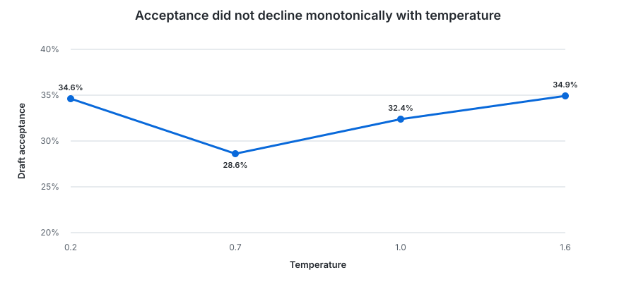
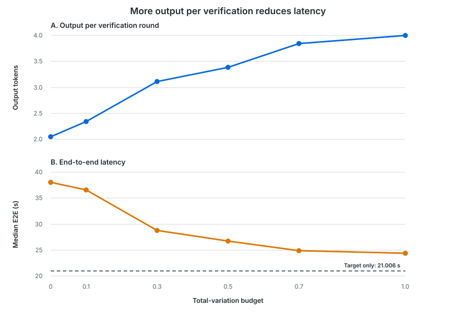

# Speculative Sampling Tradeoffs

Speculative decoding uses a smaller model to propose tokens and a target model
to verify them. Under greedy decoding, verification can compare token IDs. With
multinomial sampling, it must instead account for the target and draft
probability distributions. Lossless speculative sampling preserves the target
distribution exactly, but low agreement between the two models can reject most
draft work and make speculation slower than target-only decoding.

The earlier [speculative decoding policy benchmark](speculative_decoding.md)
measured the same Qwen model pair and creative-writing prompt under greedy
decoding. Fixed-4 speculation accepted only 31.1% of proposed tokens and was
52.7% slower than target-only decoding, establishing this workload as a
low-acceptance case before introducing multinomial sampling.

Mentored decoding introduces a total-variation (TV) budget that permits a
bounded shift toward the draft distribution. This benchmark asks how sampling
temperature affects lossless acceptance, how increasing that budget changes
speed, and whether the resulting creative-writing samples remain plausible to
a reader.

## Scope

- The experiment covers one Qwen target/draft pair and one creative-writing
  prompt. It does not establish a general safe TV budget.
- Concurrent requests, memory consumption, other model pairs, and top-k or
  top-p sampling are out of scope.

## Reproducibility

| Item | Details |
|---|---|
| Hardware | Apple M2 with an 8-core CPU, 10-core GPU, and 16 GB of unified memory |
| Operating system | macOS 27.0.1 (build 26A434) |
| Models | Qwen2.5 7B Instruct Q4_K_M as the target and Qwen2.5 0.5B Instruct Q4_K_M as the draft; both use the Qwen2.5 7B tokenizer |
| Revisions | [`mini-vllm-rs` `1599357`](https://github.com/lun0522/mini-vllm-rs/commit/1599357f93cea7a085f7d48e08fc4c54d1ca7554) and [`mini-vllm-eval` `aadee35`](https://github.com/lun0522/mini-vllm-eval/commit/aadee35324d05e8fe57288f991b2bcfcb204a444) |
| Procedure | Follow the `speculative-sampling-tradeoff-benchmark` skill in `mini-vllm-eval` and run `speculative_sampling_tradeoff` |
| Configuration | Metal GPU inference with F32 activations, a contiguous 1 GiB target KV cache, a maximum batched token count of 1,024, fixed-4 speculation, and `MINI_VLLM_METAL_GEMV_MAX_ROWS=4` |
| Sampling | Repetition penalty 1.1 over the last 64 tokens; seeds 17, 101, and 20261022 |
| Workload | An 845-token creative-writing prompt followed by exactly 256 generated tokens with EOS ignored and streamed output |
| Measurements | 3 sequential untraced invocations. Each invocation used one 1-token warm-up per fresh server and 30 measured requests. Across invocations, results report the mean and sample standard deviation of the median over three seeds. The maximum headline coefficient of variation was 2.29%, for fixed-4 decode throughput at temperature 1.6 and TV budget 0, so the planned three runs were sufficient |
| Thread settings | `CANDLE_NUM_THREADS` and `RAYON_NUM_THREADS` unset |

The three fixed seeds produced identical generated text and draft-token
statistics in every invocation. Timing values still varied slightly, so each
complete invocation remains one independent performance sample.

## Algorithm

Let `p` be the target distribution and `q` the draft distribution after
temperature and repetition penalties. For TV budget `D`, the implementation
uses

```text
d = D_TV(p, q) = sum_token max(p(token) - q(token), 0)
theta = 1 if d <= D, otherwise D / d
pi = theta * q + (1 - theta) * p
```

A proposed token `x` is accepted with probability
`min(1, theta + (1 - theta) * p(x) / q(x))`. At the first rejection, the
sampler draws a replacement from the normalized positive residual
`max(p - q, 0)` and discards the remaining proposals. The output token follows
`pi`, whose TV distance from `p` is at most `D` for that step. This is the
linear-interpolation construction from Lemma 3.2 and Theorem 3.4 of
[Tran-Thien and Nock, *Mentored Decoding: Faster Inference meets Boosting*](https://arxiv.org/abs/2609.30474).

At budget 0, `pi = p`, giving lossless speculative sampling. At budget 1, the
budget covers every possible TV distance, `pi = q`, and every draft proposal is
accepted. This implementation emits no additional target bonus token after a
fully accepted proposal, so fixed-4 produces at most 4 output tokens per target
verification round.

## Workloads

The measured request asks for a literary science-fiction scene about two
characters investigating a distress signal in an abandoned lunar greenhouse.
Two fixed-4 sweeps isolate the effects of temperature and the TV budget:

| Sweep | Temperature | TV budget | Purpose |
|---|---|---|---|
| Temperature | 0.2, 0.7, 1.0, and 1.6 | 0 | Tests whether hotter lossless sampling further reduces acceptance on this low-agreement workload. |
| TV budget | 0.7 | 0, 0.1, 0.3, 0.5, 0.7, and 1.0 | Measures how relaxing the target-distribution constraint changes acceptance, speed, and generated text. |

Temperature 0.7 is a practical stochastic setting and was the
lowest-acceptance point in the lossless sweep. A target-only run at that
temperature provides the performance baseline for the budget sweep.

## Metrics

- **End-to-end (E2E) latency:** Time from request submission through the final
  streamed response.
- **Decode throughput:** The 255 tokens after the first output token divided by
  E2E latency minus time to first token.
- **Output per round:** The average number of generated tokens produced by each
  target verification, including the replacement token after a rejection.

## Temperature Did Not Produce a Monotonic Acceptance Trend

The lossless sweep kept the TV budget at 0. Acceptance stayed low across the
entire temperature range, but it did not decrease monotonically. It was lowest
at temperature 0.7, then recovered at 1.0 and 1.6.



The target and draft distributions changed with temperature, but their overlap
for the sampled sequence did not follow a simple one-directional relationship.
This result rules out a monotonic decrease for this workload. With one prompt
and three seeds, it does not establish how temperature affects acceptance more
generally.

At temperature 0.7, lossless fixed-4 decoding was **81.3% slower** in E2E
latency than target-only decoding and achieved only **47.0%** of its decode
throughput. Accepting 1.134 draft tokens per round did not repay the sequential
draft-model work.

## A Larger TV Budget Recovered Performance but Did Not Beat Target-Only

The budget sweep held temperature at 0.7. Increasing the budget raised
acceptance from 28.6% to 100% and reduced E2E latency at every measured step.
It also increased output per verification round from 2.053 to the fixed-4
maximum of 4. The two panels keep verification efficiency and latency on
separate axes while showing their shared progression across the budget sweep.



Relative to lossless speculation, budget 0.3 reduced median E2E by **24.5%**,
budget 0.5 by **29.7%**, budget 0.7 by **34.7%**, and budget 1 by **36.1%**.
The largest changes occurred before complete acceptance: moving from budget 0.1
to 0.3 added 26.2 percentage points of acceptance and removed 7.858 seconds.

No fixed-4 setting beat target-only decoding, though. Even at budget 1, where
every proposal was accepted, speculation remained **15.9% slower** in E2E
latency and its decode throughput was **12.9% lower**. Distributional agreement
was therefore no longer the only constraint. Four accepted tokens per
verification round did not amortize the draft-model and verification costs
enough on this model pair and hardware.

## The Text Samples Show a Qualitative Tradeoff, Not a Quality Threshold

The benchmark stops after 256 generated tokens, so the text samples cover only
the beginning of the requested story. Across the six text samples retained in
the appendix, every sample was readable and followed the broad lunar-greenhouse
setting.

Budget 0.5 raised acceptance to 76.7% while remaining coherent and close to the
supplied setting:

> The greenhouse's central aisle was a labyrinth of dry hydroponic beds and
> collapsed irrigation tubes.

At budget 0.7, the sample remained grammatical but added the arbitrary detail
of unseen footsteps:

> Ilyan Sato and Mara Venn stood silent, their voices barely audible over the
> cacophony of distant machinery and unseen footsteps.

At budget 1, the sample remained grammatical, but the terminal commanding the
engineers and the unexplained triangular structure were harder to connect to
the requested scene:

> Ilyan Sato and Mara Venn worked as maintenance engineers under the command of
> the old maintenance terminal near the second door. Mara strode through the
> dusty corridors, her footsteps echoing off the concrete floor. She saw a
> triangular structure rising from the ground.

Quality did not decline monotonically with the budget. For example, the budget
0.3 sample contained awkward phrases such as “the roof lights up below” and
“expected dimness and dust fill,” while the budget 0.5 sample read more
smoothly. One seed's first 500 characters cannot rank literary quality or
identify a maximum acceptable budget. The text samples are retained in the
appendix so readers can inspect the actual evidence rather than treating the TV
budget as a proxy for semantic correctness.

## Conclusions

1. **Temperature alone did not predict draft acceptance.** Lossless acceptance
   ranged from 28.6% to 34.9% and was lowest at temperature 0.7 rather than at
   the highest temperature.
2. **The TV budget controlled a strong speed-versus-fidelity tradeoff.** Budget
   0.5 raised acceptance to 76.7% and reduced E2E latency by 29.7% relative to
   lossless speculation while its displayed text sample remained coherent.
3. **Higher acceptance did not guarantee a target-only speedup.** Fixed-4 was
   still 15.9% slower at 100% acceptance, showing that proposal length and
   draft cost remain material after rejection overhead disappears.
4. **The collected text does not establish a safe budget.** The TV guarantee is
   distributional, and the limited text samples neither showed a monotonic
   quality trend nor supported a broader quality claim.

## Appendix

The first two tables provide the values summarized by the charts. The complete
aggregates, per-invocation measurements, and representative text samples
follow.

### Temperature Sweep

| Temperature | Median E2E (s) | Decode (tok/s) | Acceptance | Accepted per round | Output per round |
|---:|---:|---:|---:|---:|---:|
| 0.2 | 37.147 ± 0.438 | 8.828 ± 0.132 | 34.6% | 1.377 | 2.246 |
| 0.7 | 38.076 ± 0.093 | 8.548 ± 0.022 | 28.6% | 1.134 | 2.053 |
| 1.0 | 38.356 ± 0.273 | 8.469 ± 0.073 | 32.4% | 1.288 | 2.145 |
| 1.6 | 36.674 ± 0.649 | 8.975 ± 0.206 | 34.9% | 1.383 | 2.246 |

### TV Budget Sweep

Relative E2E speed is target-only E2E latency divided by the configuration's
E2E latency, so values below 1 indicate a slowdown.

| Configuration | TV budget | Median E2E (s) | Decode (tok/s) | Relative E2E speed | Acceptance | Accepted per round | Output per round |
|---|---:|---:|---:|---:|---:|---:|---:|
| Target only | - | 21.006 ± 0.237 | 18.194 ± 0.311 | 1.000× | - | - | - |
| Fixed 4 | 0 | 38.076 ± 0.093 | 8.548 ± 0.022 | 0.552× | 28.6% | 1.134 | 2.053 |
| Fixed 4 | 0.1 | 36.599 ± 0.165 | 9.009 ± 0.044 | 0.574× | 38.5% | 1.527 | 2.341 |
| Fixed 4 | 0.3 | 28.741 ± 0.040 | 12.465 ± 0.025 | 0.731× | 64.7% | 2.563 | 3.109 |
| Fixed 4 | 0.5 | 26.774 ± 0.115 | 13.792 ± 0.075 | 0.785× | 76.7% | 3.048 | 3.383 |
| Fixed 4 | 0.7 | 24.865 ± 0.199 | 15.351 ± 0.187 | 0.845× | 94.0% | 3.750 | 3.840 |
| Fixed 4 | 1.0 | 24.349 ± 0.207 | 15.848 ± 0.174 | 0.863× | 100.0% | 4.000 | 4.000 |

### Complete Aggregate Measurements

Values are the mean ± sample standard deviation of the three per-invocation
medians. The range covers all nine measured requests for the setting. Token
counts are pooled across all runs; because each invocation used the same three
seeds, each one contributed exactly one third of the displayed count.

| Temperature | TV budget | E2E (s) [observed range] | Decode (tok/s) | Relative E2E speed | Acceptance | Accepted/proposed | Accepted per round | Output per round |
|---:|---:|---:|---:|---:|---:|---:|---:|---:|
| 0.7 target only | - | 21.006 ± 0.237 [20.537, 21.306] | 18.194 ± 0.311 | 1.000× ± 0.000× | - | - | - | - |
| 0.2 | 0 | 37.147 ± 0.438 [34.919, 38.068] | 8.828 ± 0.132 | - | 34.6% | 1413/4089 | 1.377 ± 0.000 | 2.246 ± 0.000 |
| 0.7 | 0 | 38.076 ± 0.093 [36.490, 42.722] | 8.548 ± 0.022 | 0.552× ± 0.005× | 28.6% | 1272/4449 | 1.134 ± 0.000 | 2.053 ± 0.000 |
| 1.0 | 0 | 38.356 ± 0.273 [36.302, 39.125] | 8.469 ± 0.073 | - | 32.4% | 1383/4272 | 1.288 ± 0.000 | 2.145 ± 0.000 |
| 1.6 | 0 | 36.674 ± 0.649 [35.813, 37.427] | 8.975 ± 0.206 | - | 34.9% | 1419/4068 | 1.383 ± 0.000 | 2.246 ± 0.000 |
| 0.7 | 0.1 | 36.599 ± 0.165 [32.824, 38.299] | 9.009 ± 0.044 | 0.574× ± 0.004× | 38.5% | 1503/3903 | 1.527 ± 0.000 | 2.341 ± 0.000 |
| 0.7 | 0.3 | 28.741 ± 0.040 [28.132, 29.699] | 12.465 ± 0.025 | 0.731× ± 0.007× | 64.7% | 1899/2934 | 2.563 ± 0.000 | 3.109 ± 0.000 |
| 0.7 | 0.5 | 26.774 ± 0.115 [26.409, 28.438] | 13.792 ± 0.075 | 0.785× ± 0.007× | 76.7% | 2076/2706 | 3.048 ± 0.000 | 3.383 ± 0.000 |
| 0.7 | 0.7 | 24.865 ± 0.199 [24.228, 25.073] | 15.351 ± 0.187 | 0.845× ± 0.007× | 94.0% | 2250/2394 | 3.750 ± 0.000 | 3.840 ± 0.000 |
| 0.7 | 1.0 | 24.349 ± 0.207 [23.664, 24.774] | 15.848 ± 0.174 | 0.863× ± 0.014× | 100.0% | 2304/2304 | 4.000 ± 0.000 | 4.000 ± 0.000 |

### Per-Invocation Medians

Each cell contains `median E2E seconds [minimum, maximum] / median decode tokens
per second` over the three fixed seeds in that invocation. Together with the
aggregate token counts above, these rows retain the per-invocation measurements
used in the report's aggregate results.

| Temperature | TV budget | Run 1 | Run 2 | Run 3 |
|---:|---:|---:|---:|---:|
| 0.7 target only | - | 21.025 [20.757, 21.116] / 18.182 | 21.233 [20.807, 21.306] / 17.890 | 20.761 [20.537, 21.120] / 18.511 |
| 0.2 | 0 | 37.368 [34.919, 38.068] / 8.760 | 37.431 [35.026, 37.798] / 8.745 | 36.643 [34.952, 37.302] / 8.980 |
| 0.7 | 0 | 38.119 [36.724, 42.722] / 8.540 | 38.139 [36.490, 42.005] / 8.532 | 37.968 [37.146, 42.123] / 8.573 |
| 1.0 | 0 | 38.432 [36.972, 38.481] / 8.451 | 38.052 [36.844, 38.659] / 8.549 | 38.582 [36.302, 39.125] / 8.408 |
| 1.6 | 0 | 36.755 [35.813, 37.060] / 8.948 | 37.279 [35.909, 37.427] / 8.784 | 35.989 [35.986, 36.551] / 9.194 |
| 0.7 | 0.1 | 36.587 [33.133, 37.354] / 9.019 | 36.770 [32.824, 37.015] / 8.961 | 36.441 [32.974, 38.299] / 9.047 |
| 0.7 | 0.3 | 28.761 [28.132, 29.628] / 12.455 | 28.767 [28.224, 29.699] / 12.447 | 28.695 [28.158, 29.477] / 12.494 |
| 0.7 | 0.5 | 26.879 [26.409, 28.341] / 13.713 | 26.792 [26.666, 28.438] / 13.800 | 26.651 [26.619, 28.403] / 13.862 |
| 0.7 | 0.7 | 25.052 [24.587, 25.073] / 15.189 | 24.887 [24.742, 25.001] / 15.310 | 24.656 [24.228, 24.823] / 15.555 |
| 0.7 | 1.0 | 24.574 [24.106, 24.774] / 15.661 | 24.165 [23.664, 24.590] / 16.004 | 24.309 [24.218, 24.397] / 15.880 |

### Representative Seed-101 Text Samples

These are the normalized first 500 characters emitted by the benchmark at
temperature 0.7. Every sample was identical across all three invocations and is
intentionally truncated after 500 characters.

**TV budget 0**

> The air in the greenhouse was stale and heavy with dust. Mara Venn stepped into the first zone through an emergency door, her boots crunching on the dry substrate of what had once been soil. The central aisle was dimly lit by slivers of reflected Earthlight that cut through the electrostatic haze settling over everything. She paused to wipe a smear of condensation from a window pane, her hand lingering as she traced the pattern of water droplets where none should have appeared. Mara had known th

**TV budget 0.1**

> The air in the greenhouse crackled with a stale humidity that clung to Mara Venn’s skin like old sweat. She stood by one of the emergency doors, her fingers brushing against the smooth, almost polished metal frame. It had been twenty years since this place saw power or even a breath of fresh air, and yet... A drop of water condensed on the glass surface, tracing a path across the window. The greenhouses were supposed to be sealed—airtight and dry. But here in this abandoned section, where it was

**TV budget 0.3**

> The greenhouse's transparent roof lights up below, casting a faint blue glow over the central aisle of hydroponic beds. Mara Venn, the station mechanic, had expected dimness and dust fill the chamber when she first approached the door. Now it was different—too much light, even though the power hadn't been turned on in twenty years. She thought about the signal again—a repeating pulse that seemed to emanate from a distant system but left no indication of where it was coming from or what caused it

**TV budget 0.5**

> The greenhouse's central aisle was a labyrinth of dry hydroponic beds and collapsed irrigation tubes. The station corridor led to the second zone, where a thin stale atmosphere hung in the air like an old, forgotten perfume. Ilyan Sato stood aside as Mara Venn approached the sealed door, her movements steady but reserved. Mara glanced at the broken window, the first visible sign of the greenhouse's awakening. "It's real, isn't it?" she said, her voice barely above a whisper. Ilyan hesitated, his

**TV budget 0.7**

> The greenhouse's central aisle was a labyrinth of dry hydroponic beds and collapsed irrigation tubes. The station corridor led to an emergency door that opened into the third zone, where Ilyan Sato and Mara Venn stood silent, their voices barely audible over the cacophony of distant machinery and unseen footsteps. Mara glanced at the ceiling, her eyes widening as she saw the first stained layer of condensation on a window protecting the greenhouse from the stinging lunar sunlight. She had suspec

**TV budget 1.0**

> The greenhouse's central aisle was a labyrinth of dry hydroponic beds and collapsed irrigation tubes. The station corridor led to an emergency door that opened into the third zone, where Ilyan Sato and Mara Venn worked as maintenance engineers under the command of the old maintenance terminal near the second door. Mara strode through the dusty corridors, her footsteps echoing off the concrete floor. She saw a triangular structure rising from the ground, a reflective surface over the windows that

