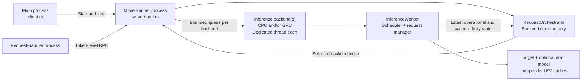
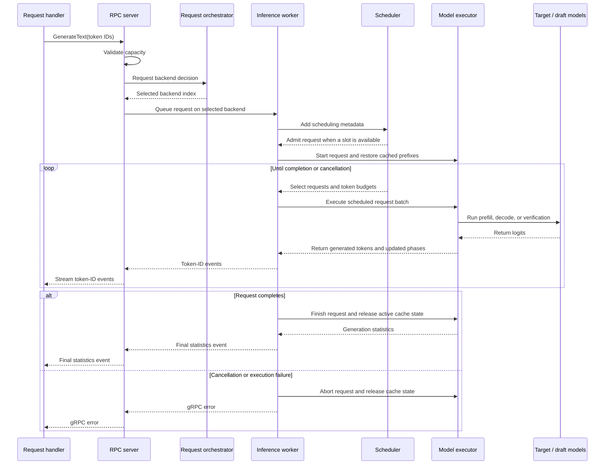

# Model runner architecture

The `model_runner` module owns model execution. Its lifecycle client runs in the
main process; the RPC server, inference backends, loaded models, schedulers, and
KV caches run in the model-runner process.

## Process and backend topology

CPU-only and GPU-only modes create one backend. Mixed mode creates both and
routes whole requests between their bounded queues. Each backend has its own
inference thread, scheduler, loaded models, and KV caches; a request is never
split across devices.

The server binds its Unix socket only after every configured backend has loaded
its models, making the socket a readiness signal. After startup, inference
requests arrive directly from the request-handler process rather than passing
through the lifecycle client.

## Component responsibilities

| Component | Responsibility |
| --- | --- |
| `client.rs` | Starts and stops the process, waits for readiness, and owns socket cleanup. |
| `server/cli.rs` | Receives model paths, device mode, cache settings, and scheduler settings from the main process. |
| `server/mod.rs` | Serves tonic RPCs, validates request capacity, and dispatches requests to inference backends. |
| `server/request_orchestrator.rs` | Selects an inference backend for each request without owning or dispatching through backend queues. |
| `server/inference_worker.rs` | Coordinates admission, scheduled execution, event delivery, timing, and cleanup for one backend. |
| `server/request_manager.rs` | Owns request payloads, resumable execution state, response channels, and lifecycle timing. |
| `server/scheduler.rs` | Owns scheduling metadata and applies active-request, KV-cache reservation, and token-budget limits. |
| `server/prefix_cache_flight.rs` | Coordinates exact-input single flights and tracks whether followers wait for leader completion or prefix publication. |
| `server/model_executor.rs` | Owns the target and optional draft model instances and manages their request lifecycles. |
| `server/model_instance.rs` | Pairs one loaded model with its request-aware KV-cache manager. |
| `server/text_generation.rs` | Implements resumable prefill, ordinary decoding, speculative decoding, and sampling. |
| `server/generation_stats.rs` | Defines generation outcomes and execution, draft-model, and prefix-cache statistics. |
| [`server/kv_cache/`](server/kv_cache/README.md) | Implements contiguous and paged storage, prefix reuse, and per-request cache state. |

Tokenization, tokenizer compatibility checks, and incremental text decoding
belong to the request-handler process. The model runner receives token IDs and
returns token IDs followed by final generation statistics.

## Request lifecycle

The RPC server rejects empty inputs or inputs larger than the effective
KV-cache capacity: the target capacity without speculative decoding, or the
smaller target/draft capacity with it. If the requested output would exceed the
remaining capacity, it reduces `max_new_tokens` before queueing the request.

## Request orchestration

The request orchestrator owns only the configured backend-selection policy
state and returns a backend index. The RPC service retains ownership of the
backend queues and dispatches each request according to that decision.

Workers publish replaceable operational and cache-affinity snapshots to the
orchestrator at sparse request-lifecycle boundaries:

- Operational snapshots contain:
  - Queued and active request counts.
  - Queued and active remaining prefill-token counts.
  - Queued and active remaining maximum output-token counts.
- Cache-affinity snapshots remain separate so load-only policies do not depend
  on cache contents.

The available request-routing policies are:

- `round-robin`, which selects backends cyclically without inspecting worker
  state.
- `least-requests`, which selects the backend with the smallest sum of queued
  and active requests. Equal scores select the least recently used backend.
- `least-estimated-work`, which divides each backend's estimated remaining
  queued and active tokens, including the incoming request, by a fixed
  benchmark-derived throughput weight. The CPU and GPU weights are 9.22 and
  16.25 output tokens/s,
  respectively, from the batched target-only results in
  [`metal_gemv_threshold.md`](../../benchmarks/metal_gemv_threshold.md). Equal
  scores select the least recently used backend. These weights are specific to
  the benchmark's Apple M2 and Qwen2.5 7B configuration and intentionally serve
  as a simple fixed-weight baseline rather than hardware-independent estimates.
- `most-cached-prefix`, which selects the backend with the longest cached
  complete-block prefix for the incoming request. Equal matches select the
  least recently used backend. This policy requires prefix caching on every
  backend and does not account for backend load.

Operational snapshots are intentionally approximate: requests still in a
backend's message channel are not represented until its worker receives them,
and routing does not reserve capacity before dispatch.

## Scheduling

Each backend admits requests while both active-request slots and KV-cache pages
remain. A request reserves enough page-rounded capacity for
`input_token_count + max_new_tokens - 1` cached tokens; the final generated
token remains pending and therefore needs no cache slot. Admission preserves
the configured policy order and stops when the next request does not fit.

Reservations conservatively ignore prefix-cache hits, while inactive cached
prefix pages remain reclaimable through the existing LRU eviction path. A
request releases its reservation when it finishes or is removed after an error
or cancellation.

### Prefix-cache publication and coordination

Prefix-cache publication controls when complete pages become reusable:

- `on-request-completion` publishes when `finish_request()` finalizes the
  request.
- `incremental` additionally publishes newly completed pages after every
  successful execution step. Finalization still performs one last publication
  to capture any remaining complete page.

Prefix-cache coordination independently controls how concurrent requests with
identical inputs populate the cache:

- `independent` schedules every request normally, so concurrent cold requests
  may compute and attempt to publish the same prefix.
- `exact-input-single-flight-until-request-completion` selects the first
  request as leader and blocks identical followers until that request finishes.
- `exact-input-single-flight-until-prefix-published` blocks identical followers
  only until the leader finishes prefill and publishes the shared prefix. This
  policy requests a publication checkpoint at that boundary even when the
  configured publication policy is `on-request-completion`.

Released followers restore the published prefix through normal cache lookup.
Later identical requests create a new flight and may reuse the same cached
prefix. If an active leader aborts before releasing its followers, the oldest
waiting follower becomes the new leader.

Admitted requests build batches within the scheduler's token budget. Decode
work is prioritized over prefill work; prefills are ordered either
first-come-first-served or shortest-prefill-first. Long prefills can be split
across scheduling iterations.

Paged KV caching supports multiple active requests and continuous batching. A
contiguous cache permits only one active request, so the inference worker
automatically limits its scheduler accordingly.

## Speculative decoding

When a draft model is configured, target and draft models restore cached prompt
prefixes independently and prefill through the second-to-last input token. The
draft model proposes tokens, and the target verifies proposals for scheduled
requests in a batched forward pass. The longest matching prefix is accepted;
after verification, both caches are truncated to discard state derived from
any rejected proposals.

Without a draft model, requests use ordinary target-only prefill and decode.
Both paths remain resumable between scheduling iterations and report
request-level timing. Speculative responses additionally report accepted and
proposed draft-token totals, from which clients can derive the acceptance rate,
and a histogram of the proposal lengths selected by the draft-token policy.

## KV-cache execution

Each model instance owns a separate cache manager. The target cache uses the
configured byte budget. The optional draft cache uses its configured byte
budget when present; otherwise, its budget is inferred to provide the same
token capacity as the target cache.

Paged storage works on CPU and GPU backends. Direct paged attention is currently
CPU-only and opt-in; other execution paths reconstruct contiguous key/value
tensors from the pages before attention. Prefix-enabled paged caches retain
complete blocks for reuse across requests. See the
[KV-cache architecture](server/kv_cache/README.md) for allocation, prefix
indexing, eviction, and page ownership details.

A successful request ends with a `TextGenerationStats` event. Its finish reason
reports whether generation sampled an end-of-sequence token or reached the
effective maximum new-token count. A `MAX_NEW_TOKENS_REACHED` result
with fewer output tokens than the client originally requested indicates that
the model context or KV-cache capacity reduced the requested limit. Cancellation
or execution failure aborts the request, releases its model and cache state, and
returns a gRPC error.
