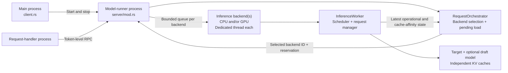
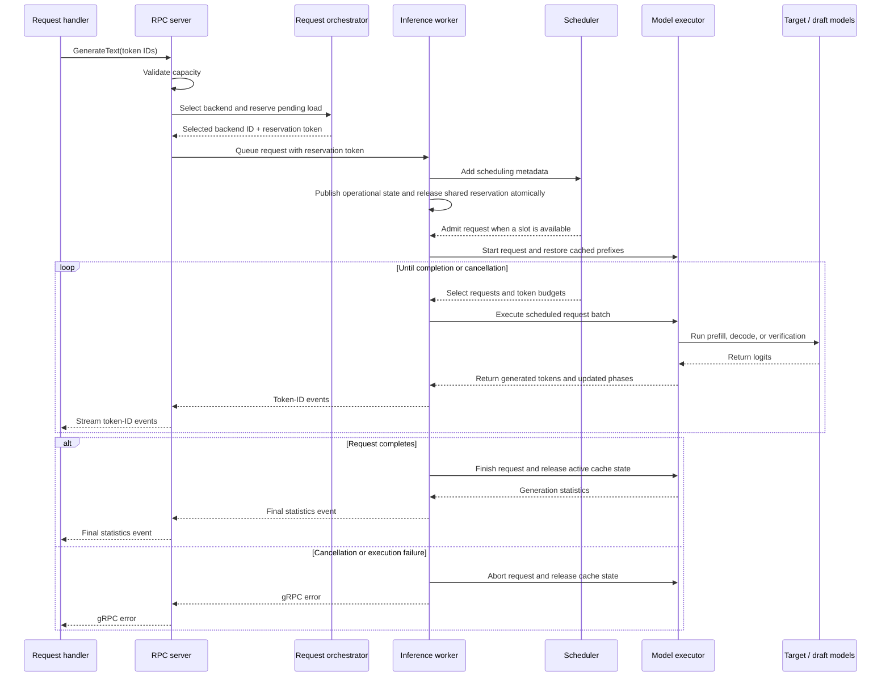

# Model runner architecture

The `model_runner` module owns model execution. Its lifecycle client runs in the
main process; the RPC server, inference backends, loaded models, schedulers, and
KV caches run in the model-runner process.

## Process and backend topology

CPU-only and GPU-only modes create one backend. Mixed mode creates both and
routes whole requests between their bounded queues. Each backend has its own
inference thread, scheduler, loaded models, and KV caches; a request is never
split across devices.

The server binds its Unix socket only after every configured backend has loaded
its models, making the socket a readiness signal. After startup, inference
requests arrive directly from the request-handler process rather than passing
through the lifecycle client.

## Component responsibilities

The server modules are grouped by responsibility:

- `server/routing/` selects a backend and reserves its capacity.
- `server/execution/` manages requests, schedules work, and runs the worker loop.
  `prefix_cache_flight` belongs here because it coordinates request admission.
- `server/generation/` implements token generation, sampling, and speculative
  decoding behavior.
- `server/kv_cache/` owns KV-cache storage and prefix reuse.

`model_executor.rs` and `model_instance.rs` remain directly under `server/` and
connect generation with model and cache ownership.

| Component | Responsibility |
| --- | --- |
| `client.rs` | Starts and stops the process, waits for readiness, and owns socket cleanup. |
| `server/cli.rs` | Receives model paths, device mode, cache settings, and scheduler settings from the main process. |
| `server/mod.rs` | Serves tonic RPCs, validates request capacity, and dispatches requests to inference backends. |
| `server/routing/request_orchestrator.rs` | Selects an inference backend and reserves its pending request load without owning or dispatching through backend queues. |
| `server/routing/routing_policy.rs` | Scores candidate backends using worker snapshots and outstanding reservations, with policy-specific selection and tie-breaking. |
| `server/execution/inference_worker.rs` | Coordinates admission, scheduled execution, event delivery, timing, and cleanup for one backend. |
| `server/execution/request_manager.rs` | Owns request payloads, resumable execution state, response channels, and lifecycle timing. |
| `server/execution/scheduler.rs` | Owns scheduling metadata and applies active-request, KV-cache reservation, and token-budget limits. |
| `server/execution/prefix_cache_flight.rs` | Coordinates exact-input single flights and tracks whether followers wait for leader completion or prefix publication. |
| `server/model_executor.rs` | Owns the target and optional draft model instances and manages their request lifecycles. |
| `server/model_instance.rs` | Pairs one loaded model with its request-aware KV-cache manager. |
| `server/generation/text_generation.rs` | Implements resumable prefill, ordinary decoding, speculative decoding, and sampling. |
| `server/generation/sampler.rs` | Applies repetition penalties, greedy or seeded temperature sampling, and stochastic speculative acceptance and residual sampling. |
| `server/generation/draft_token_count.rs` | Controls the number of draft tokens proposed per speculative iteration. |
| `server/generation/generation_stats.rs` | Defines generation outcomes and execution, draft-model, and prefix-cache statistics. |
| [`server/kv_cache/`](server/kv_cache/README.md) | Implements contiguous and paged storage, prefix reuse, and per-request cache state. |

Tokenization, tokenizer compatibility checks, and incremental text decoding
belong to the request-handler process. The model runner receives token IDs and
returns token IDs followed by final generation statistics.

## Request lifecycle

The RPC server rejects empty inputs or inputs larger than the effective
KV-cache capacity: the target capacity without speculative decoding, or the
smaller target/draft capacity with it. If the requested output would exceed the
remaining capacity, it reduces `max_new_tokens` before queueing the request.

## Request orchestration

The request orchestrator owns the configured backend-selection policy state and
pending-load reservations. It returns a one-based backend ID and a reservation
token. The RPC service retains ownership of the backend queues and dispatches
each request with its token according to that decision.

Workers publish replaceable operational and cache-affinity snapshots to the
orchestrator at sparse request-lifecycle boundaries:

- Operational snapshots contain:
  - An independently increasing publication epoch.
  - Queued and active request counts.
  - Queued and active remaining prefill-token counts.
  - Queued and active remaining maximum output-token counts.
- Cache-affinity snapshots contain:
  - An independently increasing publication epoch.
  - The backend's prefix-cache index when prefix caching is enabled.

Cache-affinity snapshots remain separate so load-only policies do not depend
on cache contents. Routing logs record the request dimensions, selected
backend, routing duration, and the snapshot epochs and scoring inputs inspected
for each candidate backend. Decisions and their candidate logs share a one-based
`routing_epoch`, assigned during selection under the reservation lock. Use that
epoch rather than log-line order to reconstruct routing order, since logging
runs outside the lock. Final generation statistics include `request_id`, matching
the server logs, so clients can correlate each workload with its decision.
Both identifiers are local to the running server and reset on restart.
Candidate diagnostics record published operational
load separately from outstanding reserved load, before reserving the incoming
request. Both estimated-work policies also log `estimated_duration_ns`, the
exact integer duration score used to rank each backend, not measured latency.

The available request-routing policies are:

- `round-robin`, which selects backends cyclically without inspecting worker
  state.
- `least-requests`, which selects the backend with the smallest sum of queued
  and active requests. Equal scores select the least recently used backend.
- `least-estimated-work`, which estimates completion time by dividing remaining
  prefill and decode token counts—including the incoming request—by their
  respective workload-specific throughput rates and adding the two durations.
  It selects the configured profile with the smallest combined absolute
  difference in input and maximum output token counts; equal distances preserve
  configuration order. The fallback is the 128-input-token,
  512-maximum-output-token profile measured in
  [`backend_throughput_profiles.md`](../../benchmarks/backend_throughput_profiles.md):
  CPU prefill/decode rates of `75`/`48` tokens per second and GPU rates of
  `12086`/`396`. Equal scores select the least recently used backend. These
  Apple M2 and Qwen2.5 0.5B measurements intentionally serve as a simple baseline;
  the request-orchestrator configuration can supply profiles from another
  environment.
- `most-cached-prefix`, which selects the backend with the longest cached
  complete-block prefix restorable for the incoming request. Equal matches
  select the least recently used backend. This policy requires prefix caching
  on every backend and does not account for backend load.
- `cache-aware-least-estimated-work`, which uses the same load and throughput
  estimate as `least-estimated-work` but excludes the incoming request's cached
  complete-block prefix from its prefill work. Equal scores select the least
  recently used backend. This policy requires prefix caching on every backend.

### Pending-load reservations

The orchestrator and each `RoutingReservation` token share an
`Arc<Mutex<OrchestratorRoutingState>>`. It holds the global selection epoch and
one `BackendRoutingState` per backend, grouping its reserved load and
last-selected epoch. Policies retain only policy-specific inputs; the shared
selection helper handles tie-breaking and epoch updates without policy-local
locks. Selecting a backend and adding its reservation happen under the same
lock, so concurrent routing decisions account for earlier selections even
before those requests reach their workers. Reservations include:

- Request count.
- Input prefill-token count and estimated cached-prefix-token count.
- Maximum output-token count.

Load-based policies merge reservations into a local copy of the worker's
operational snapshot as additional queued work. Cache-aware routing subtracts
the reserved cached-prefix estimate from reserved prefill work; load-only
policies reserve zero cached-prefix tokens. Round-robin and most-cached-prefix
record reservations but ignore them when selecting a backend.

The token accompanies the request while dispatch waits for queue space and
while the request remains in the backend channel. After successfully enqueueing
the request in its scheduler, the worker publishes its updated operational
snapshot and releases the reservation under the same mutex. Routing therefore
sees either the reservation or the published load, not both or neither.

The token uses RAII: dropping an undispatched request, a failed send, or a queued
message discarded during shutdown releases its reserved load automatically.
Worker enqueue errors also drop the token and release its load. Shared ownership
lets workers perform this cleanup directly without sending an acknowledgement
message to the orchestrator. Once handed off to a worker snapshot, the load is
tracked by the scheduler rather than the token.

Keep this shared critical section small because workers also need its lock;
queue sends, inference, and routing-log output run outside it. These reservations
account for pending work, not actual KV-cache capacity. The scheduler separately
enforces KV-page reservations at admission.

Operational snapshots remain approximate between their sparse publications,
and cached-prefix estimates can become stale. Reservations close the pending
dispatch accounting gap without increasing snapshot publication frequency.

## Scheduling

Each backend admits requests while both active-request slots and KV-cache pages
remain. A request reserves enough page-rounded capacity for
`input_token_count + max_new_tokens - 1` cached tokens; the final generated
token remains pending and therefore needs no cache slot. Admission preserves
the configured policy order and stops when the next request does not fit.

Reservations conservatively ignore prefix-cache hits, while inactive cached
prefix pages remain reclaimable through the existing LRU eviction path. A
request releases its reservation when it finishes or is removed after an error
or cancellation.

### Prefix-cache publication and coordination

Prefix-cache publication controls when complete pages become reusable:

- `on-request-completion` publishes when `finish_request()` finalizes the
  request.
- `incremental` additionally publishes newly completed pages after every
  successful execution step. Finalization still performs one last publication
  to capture any remaining complete page.

Prefix-cache coordination independently controls how concurrent requests with
identical inputs populate the cache:

- `independent` schedules every request normally, so concurrent cold requests
  may compute and attempt to publish the same prefix.
- `exact-input-single-flight-until-request-completion` selects the first
  request as leader and blocks identical followers until that request finishes.
- `exact-input-single-flight-until-prefix-published` blocks identical followers
  only until the leader finishes prefill and publishes the shared prefix. This
  policy requests a publication checkpoint at that boundary even when the
  configured publication policy is `on-request-completion`.

Released followers restore the published prefix through normal cache lookup.
Later identical requests create a new flight and may reuse the same cached
prefix. If an active leader aborts before releasing its followers, the oldest
waiting follower becomes the new leader.

Admitted requests build batches within the scheduler's token budget. Decode
work is prioritized over prefill work; prefills are ordered either
first-come-first-served or shortest-prefill-first. Long prefills can be split
across scheduling iterations.

Paged KV caching supports multiple active requests and continuous batching. A
contiguous cache permits only one active request, so the inference worker
automatically limits its scheduler accordingly.

## Speculative decoding

When a draft model is configured, target and draft models restore cached prompt
prefixes independently and prefill through the second-to-last input token. The
draft model proposes tokens, and the target verifies proposals for scheduled
requests in a batched forward pass.

With `temperature = 0`, verification accepts the longest prefix matching the
target's greedy choices. With positive temperature, both models sample over the
full vocabulary using the request's temperature and repetition penalty. Each
draft proposal retains its full distribution `q`; the target calculates `p` for
the same token prefix and accepts the proposed token `x` with probability
`min(1, p(x) / q(x))`. At the first rejection, a replacement is sampled from the
normalized positive residual `max(p - q, 0)`, and the remaining proposals are
discarded. This preserves the target sampling distribution. Both caches are
truncated to the verified prefix before the next iteration.

The request's optional `seed` initializes independent target and draft RNG
streams. Seeded speculative requests are reproducible for the same execution
configuration, but need not produce the same tokens as target-only sampling
with that seed. After full acceptance, this implementation emits the accepted
proposals without an additional bonus target token.

Without a draft model, requests use ordinary target-only prefill and decode.
Both paths remain resumable between scheduling iterations and report
request-level timing. Speculative responses additionally report accepted and
proposed draft-token totals, from which clients can derive the acceptance rate,
and a histogram of the proposal lengths selected by the draft-token policy.

## KV-cache execution

Each model instance owns a separate cache manager. The target cache uses the
configured byte budget. The optional draft cache uses its configured byte
budget when present; otherwise, its budget is inferred to provide the same
token capacity as the target cache.

Paged storage works on CPU and GPU backends. Direct paged attention is currently
CPU-only and opt-in; other execution paths reconstruct contiguous key/value
tensors from the pages before attention. Prefix-enabled paged caches retain
complete blocks for reuse across requests. See the
[KV-cache architecture](server/kv_cache/README.md) for allocation, prefix
indexing, eviction, and page ownership details.

A successful request ends with a `TextGenerationStats` event. It identifies the
one-based backend that served the request, and its finish reason reports whether
generation sampled an end-of-sequence token or reached the effective maximum
new-token count. A `MAX_NEW_TOKENS_REACHED` result with fewer output tokens than
the client originally requested indicates that the model context or KV-cache
capacity reduced the requested limit. Cancellation
or execution failure aborts the request, releases its model and cache state, and
returns a gRPC error.
